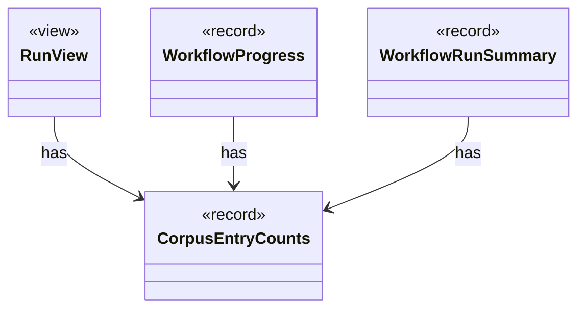

# `CorpusEntryCounts`

`io.github.tlaplus.hardening.workflow` · record · other · [source](https://github.com/tlaplus/model-checker-hardening/blob/86f4053a56eb75f027c9ac8d2b7ff84a4acf6d75/src/main/java/io/github/tlaplus/hardening/workflow/CorpusEntryCounts.java#L10) · module [workflow](../modules/workflow.md)

How many entries a corpus holds, split the way `workflow.max_entries` counts them (ADR 0034 §6): `sized` entries share the generations' sizes and are bounded by `maximum`, while `replays` come on top of them and are not.

**Decisions:** [ADR 0034: Replaying counterexamples as corpus inputs](https://github.com/tlaplus/model-checker-hardening/blob/86f4053a56eb75f027c9ac8d2b7ff84a4acf6d75/docs/decisions/0034-counterexample-replay.md)

The diagram draws 3 of 6 relations; the table lists them all.

| Direction | Relation | Type | Summary |
|---|---|---|---|
| ← | has | [RunView](io.github.tlaplus.hardening.cli.RunView.md) | The statistics shared by live and final reports, without layout or terminal state. |
| ← | has | [WorkflowProgress](io.github.tlaplus.hardening.workflow.WorkflowProgress.md) | Best-effort snapshot of cumulative corpus statistics and current pending work. |
| ← | has | [WorkflowRunSummary](io.github.tlaplus.hardening.workflow.WorkflowRunSummary.md) | Cumulative corpus statistics and stopping reason after one complete workflow invocation. |
| → | depends | [Preconditions](io.github.tlaplus.hardening.common.Preconditions.md) | Shared validation of method and constructor arguments. |
| ← | depends | [RunMetric](io.github.tlaplus.hardening.cli.RunMetric.md) | Stable field identity, independent of screen coordinates or formatted text. |
| ← | depends | [WorkflowRunner](io.github.tlaplus.hardening.workflow.WorkflowRunner.md) | Runs generation, parsing, TLC, Apalache, conformance aggregation and the quality gate under one CPU budget. |
