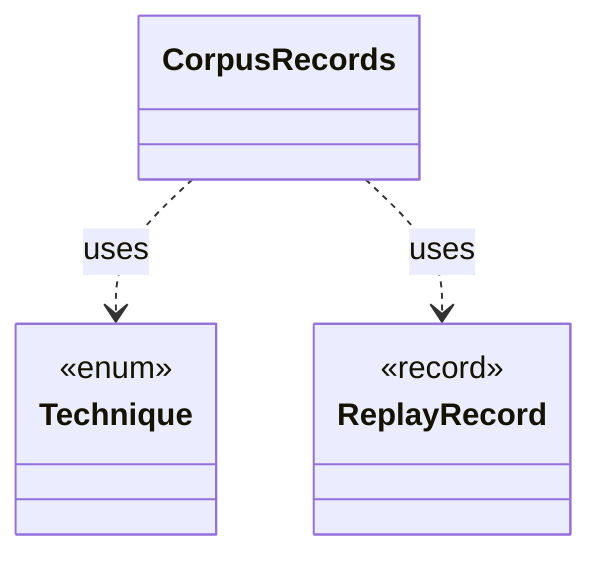

# `CorpusRecords`

`io.github.tlaplus.hardening.workflow` · class · other · [source](https://github.com/tlaplus/model-checker-hardening/blob/4df6a11e5b4bf93609393935c4cbeceec08cce0c/src/main/java/io/github/tlaplus/hardening/workflow/CorpusRecords.java#L10) · module [workflow](../modules/workflow.md)

The one corpus record still read: the technique of a corpus from before ADR 0025, whose configuration must now repeat it.

**Decisions:** [ADR 0025: Self-contained corpora, chosen at `init`](https://github.com/tlaplus/model-checker-hardening/blob/4df6a11e5b4bf93609393935c4cbeceec08cce0c/docs/decisions/0025-self-contained-corpora.md)

The diagram draws 2 of 6 relations; the table lists them all.

| Direction | Relation | Type | Summary |
|---|---|---|---|
| → | uses | [Technique](io.github.tlaplus.hardening.corpus.Technique.md) | The fuzzing technique a corpus runs: `[workflow] technique`, which `fuzztla init --how` sets (ADR 0025 §1), so every run and every replay decodes and judges its entries the same way. |
| → | uses | [ReplayRecord](io.github.tlaplus.hardening.workflow.ReplayRecord.md) | A corpus record written before ADR 0025, which no run writes any more: a run may proceed only when the configuration repeats what the record says. |
| → | depends | [CorpusRecord](io.github.tlaplus.hardening.corpus.CorpusRecord.md) | A small corpus file that pins how the corpus's entries replay. |
| ← | depends | [AdoptableBase](io.github.tlaplus.hardening.workflow.AdoptableBase.md) | The base corpus of a metamorphic run (ADR 0016 §6). |
| ← | depends | [CorpusReplay](io.github.tlaplus.hardening.workflow.CorpusReplay.md) | Decodes a corpus's entries as they were admitted: with the decoders of the configured technique, and the libraries, rules and tools the corpus holds (ADR 0025). |
| ← | depends | [WorkflowRunner](io.github.tlaplus.hardening.workflow.WorkflowRunner.md) | Runs generation, parsing, TLC, Apalache, conformance aggregation and the quality gate under one CPU budget. |
