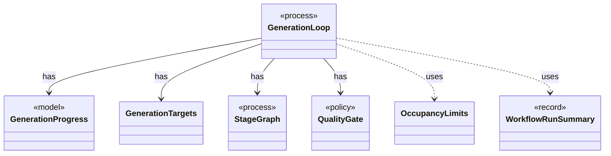

# `GenerationLoop`

`io.github.tlaplus.hardening.workflow` · class · process · key · [source](https://github.com/tlaplus/model-checker-hardening/blob/fd29bdb142d5d87538f91aeddca09d5ac3d7d0a7/src/main/java/io/github/tlaplus/hardening/workflow/GenerationLoop.java#L57) · module [workflow](../modules/workflow.md)

Runs the generations of one workflow invocation over a single stage graph (ADR 0010).

**Decisions:** [ADR 0010: Generational mutation](https://github.com/tlaplus/model-checker-hardening/blob/fd29bdb142d5d87538f91aeddca09d5ac3d7d0a7/docs/decisions/0010-mutation.md)

The diagram draws 6 of 38 relations; the table lists them all.

| Direction | Relation | Type | Summary |
|---|---|---|---|
| → | has | [GenerationProgress](io.github.tlaplus.hardening.workflow.GenerationProgress.md) | Where every generation of a run stands, tracked from stage events instead of a corpus rescan (ADR 0010). |
| → | has | [GenerationTargets](io.github.tlaplus.hardening.workflow.GenerationTargets.md) | Which target ordinals of one generation are already spoken for, and which source fills the rest (ADR 0010, ADR 0016 §6). |
| → | has | [StageGraph](io.github.tlaplus.hardening.workflow.StageGraph.md) | The stages that run one workflow invocation, wired to their queues, result capacities, and shared collaborators, and the order in which they start and stop. |
| → | has | [QualityGate](io.github.tlaplus.hardening.workflow.quality.QualityGate.md) | Selects the parents of the next generation from one settled generation (ADR 0010, ADR 0013). |
| → | uses | [OccupancyLimits](io.github.tlaplus.hardening.workflow.OccupancyLimits.md) | Checks an invocation and a recovered corpus against the configured capacity limits. |
| → | uses | [WorkflowRunSummary](io.github.tlaplus.hardening.workflow.WorkflowRunSummary.md) | Cumulative corpus statistics and stopping reason after one complete workflow invocation. |
| → | depends | [FuzzTlaConfig](io.github.tlaplus.hardening.config.FuzzTlaConfig.md) | Complete configuration of input generation and workflow execution. |
| → | depends | [MetamorphicConfig](io.github.tlaplus.hardening.config.MetamorphicConfig.md) | The `[metamorphic]` table (ADR 0016 §7, ADR 0017 §1): what a `--how=mt` run reads besides the generator settings. |
| → | depends | [MutatorConfig](io.github.tlaplus.hardening.config.MutatorConfig.md) | Generations, the quality gate's selection, and the mutator's share and operators (ADR 0010). |
| → | depends | [PbtConfig](io.github.tlaplus.hardening.config.PbtConfig.md) | Limits and collection-richness controls for property-based input generation. |
| → | depends | [QualityGateConfig](io.github.tlaplus.hardening.config.QualityGateConfig.md) | What the quality gate keeps of a settled generation (ADR 0010, ADR 0013). |
| → | depends | [WorkflowConfig](io.github.tlaplus.hardening.config.WorkflowConfig.md) | Global and per-stage limits for the implemented fuzzing workflow. |
| → | depends | [CorpusDirectory](io.github.tlaplus.hardening.corpus.CorpusDirectory.md) | Owns the on-disk layout and integrity checks for one FuzzTLA corpus. |
| → | depends | [CorpusException](io.github.tlaplus.hardening.corpus.CorpusException.md) | Reports an invalid corpus layout or corpus entry. |
| → | depends | [CorpusInput](io.github.tlaplus.hardening.corpus.CorpusInput.md) | The required fields of one encoded corpus input. |
| → | depends | [CorpusInventory](io.github.tlaplus.hardening.corpus.CorpusInventory.md) | Immutable startup inventory used to seed stage queues and capacities. |
| → | depends | [CorpusStage](io.github.tlaplus.hardening.corpus.CorpusStage.md) | One implemented stage of the fuzzing pipeline, and the corpus directories it owns. |
| → | depends | [EntryOrigin](io.github.tlaplus.hardening.corpus.EntryOrigin.md) | Which candidate source admitted an entry, as its generation metadata records it (ADR 0010, ADR 0016 §6). |
| → | depends | [InputAnalysis](io.github.tlaplus.hardening.corpus.InputAnalysis.md) | Counts the evaluated nodes, expression constructs and construct edges of one stored input, and names the rewrite rules it applied, typically by replaying it through the generator. |
| → | depends | [Ranking](io.github.tlaplus.hardening.corpus.Ranking.md) | How the quality gate ranks the admissible entries of a generation, best first: the components of its key, compared lexicographically, higher first. |
| → | depends | [ReplayedInput](io.github.tlaplus.hardening.corpus.ReplayedInput.md) | What replaying one stored input shows beyond its envelope. |
| → | depends | [Technique](io.github.tlaplus.hardening.corpus.Technique.md) | The fuzzing technique a corpus runs (`fuzztla run --how`). |
| → | depends | [Generator](io.github.tlaplus.hardening.gen.Generator.md) | A composable recipe for decoding a value from a shared `Draw` cursor. |
| → | depends | [InputKind](io.github.tlaplus.hardening.gen.InputKind.md) | What a generator payload decodes to. |
| → | depends | [ByteMutator](io.github.tlaplus.hardening.mutation.ByteMutator.md) | Derives one mutant from a parent by stacking weighted operator edits. |
| → | depends | [WorkflowException](io.github.tlaplus.hardening.workflow.WorkflowException.md) | Reports an infrastructure or lifecycle failure in a fuzzing workflow. |
| → | depends | [StageCounters](io.github.tlaplus.hardening.workflow.execution.StageCounters.md) | Verdict counters for one stage, seeded from the corpus and updated by its workers. |
| → | depends | [WorkflowControl](io.github.tlaplus.hardening.workflow.execution.WorkflowControl.md) | Shared stop state for independently running stages. |
| → | depends | [CandidateSource](io.github.tlaplus.hardening.workflow.input.CandidateSource.md) | Where the candidates for a target entry of the input stage come from: property-based generation or mutation of a selected parent (ADR 0010). |
| → | depends | [GenerationPlan](io.github.tlaplus.hardening.workflow.input.GenerationPlan.md) | One contiguous range of target entries the input stage admits: which input kind, for which generation, from which seed, how many entries from each candidate source, and with at most how many workers. |
| → | depends | [InputStage](io.github.tlaplus.hardening.workflow.input.InputStage.md) | Concurrent input stage: admits reserved target ranges from adjacent generations. |
| → | depends | [MetamorphicCandidates](io.github.tlaplus.hardening.workflow.input.MetamorphicCandidates.md) | Adopts elite conformance entries (ADR 0016 §6): every candidate is the payload of a uniformly drawn parent of a pbt corpus behind the metamorphic header, followed by random rewrite bytes. |
| → | depends | [MutantCandidates](io.github.tlaplus.hardening.workflow.input.MutantCandidates.md) | Mutants of the parent pool (ADR 0010): every candidate mutates a uniformly drawn parent, keeps its cohort, and is rejected as a clone when it renders to the parent's module. |
| → | depends | [ParentPool](io.github.tlaplus.hardening.workflow.input.ParentPool.md) | The entries of `04quality-pass` that a generation mutates or adopts: those of the kind the run generates, read once when the generation starts. |
| → | depends | [PbtCandidates](io.github.tlaplus.hardening.workflow.input.PbtCandidates.md) | Property-based candidates (ADR 0002): a target draws one richness cohort, and every candidate for it is a uniformly random byte array of a length from `InputLengthSampler`. |
| → | depends | [EvaluatedExprs](io.github.tlaplus.hardening.workflow.spec.EvaluatedExprs.md) | Replays a stored input and counts the expression constructs of the code the checkers evaluate: the definitions reachable from `SpecArtifact.entryPoints`. |
| → | depends | [SpecDecoders](io.github.tlaplus.hardening.workflow.spec.SpecDecoders.md) | Immutable registry of the decoders that turn stored payloads into checkable modules. |
| ← | depends | [WorkflowRunner](io.github.tlaplus.hardening.workflow.WorkflowRunner.md) | Runs generation, parsing, TLC, Apalache, conformance aggregation and the quality gate under one CPU budget. |
