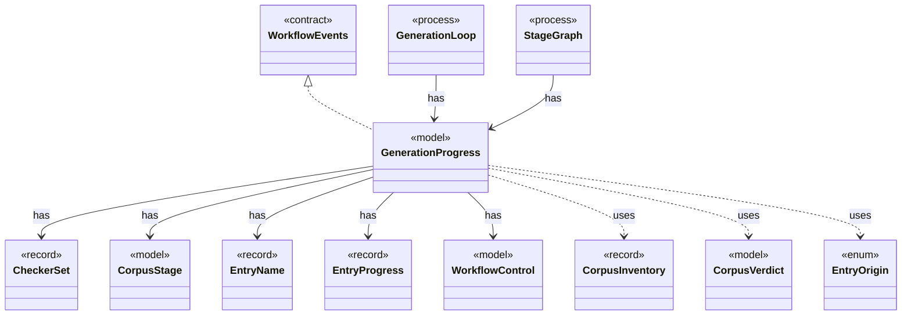

# `GenerationProgress`

`io.github.tlaplus.hardening.workflow` · class · model · key · [source](https://github.com/tlaplus/model-checker-hardening/blob/918f7db91890f302587d25c76dc7ac189db3d023/src/main/java/io/github/tlaplus/hardening/workflow/GenerationProgress.java#L44) · module [workflow](../modules/workflow.md)

Where every generation of a run stands, tracked from stage events instead of a corpus rescan (ADR 0010).

**Decisions:** [ADR 0010: Generational mutation](https://github.com/tlaplus/model-checker-hardening/blob/918f7db91890f302587d25c76dc7ac189db3d023/docs/decisions/0010-mutation.md)

| Direction | Relation | Type | Summary |
|---|---|---|---|
| → | implements | [WorkflowEvents](io.github.tlaplus.hardening.workflow.execution.WorkflowEvents.md) | Durable admission and stage transitions, reported to whatever schedules generations (ADR 0010). |
| → | has | [CheckerSet](io.github.tlaplus.hardening.corpus.CheckerSet.md) | The checker branches a corpus runs: a non-empty set of checking stages, in stage order. |
| → | has | [CorpusStage](io.github.tlaplus.hardening.corpus.CorpusStage.md) | One implemented stage of the fuzzing pipeline, and the corpus directories it owns. |
| → | has | [EntryName](io.github.tlaplus.hardening.corpus.EntryName.md) | The identity of one logical corpus entry: the file name it keeps in every stage directory it passes through. |
| → | has | [EntryProgress](io.github.tlaplus.hardening.corpus.EntryProgress.md) | How far one logical entry has moved through the pipeline, and the single definition of the two questions generation scheduling asks of it (ADR 0010). |
| → | has | [WorkflowControl](io.github.tlaplus.hardening.workflow.execution.WorkflowControl.md) | Shared stop state for independently running stages. |
| ← | has | [GenerationLoop](io.github.tlaplus.hardening.workflow.GenerationLoop.md) | Runs the generations of one workflow invocation over a single stage graph (ADR 0010). |
| ← | has | [StageGraph](io.github.tlaplus.hardening.workflow.StageGraph.md) | The stages that run one workflow invocation, wired to their queues, result capacities, and shared collaborators, and the order in which they start and stop. |
| → | uses | [CorpusInventory](io.github.tlaplus.hardening.corpus.CorpusInventory.md) | Immutable startup inventory used to seed stage queues and capacities. |
| → | uses | [CorpusVerdict](io.github.tlaplus.hardening.corpus.CorpusVerdict.md) | A verdict supported by the implemented corpus stages. |
| → | uses | [EntryOrigin](io.github.tlaplus.hardening.corpus.EntryOrigin.md) | Which candidate source admitted an entry, as its generation metadata records it (ADR 0010, ADR 0016 §6). |
