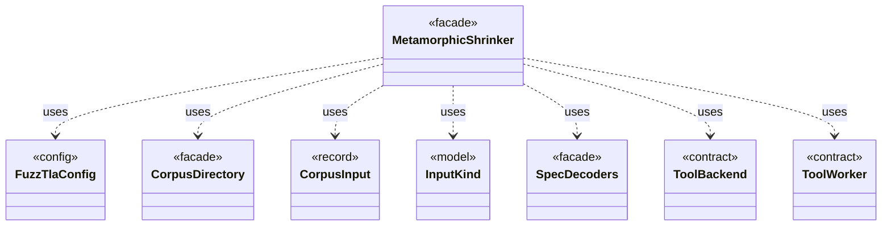

# `MetamorphicShrinker`

`io.github.tlaplus.hardening.workflow` · class · facade · key · [source](https://github.com/tlaplus/model-checker-hardening/blob/e180a3892e661e5d7ba7636c4f24a6fca66ded14/src/main/java/io/github/tlaplus/hardening/workflow/MetamorphicShrinker.java#L37) · module [workflow](../modules/workflow.md)

Reduces a metamorphic counterexample for triage (ADR 0016 §8).

**Decisions:** [ADR 0016: Metamorphic testing](https://github.com/tlaplus/model-checker-hardening/blob/e180a3892e661e5d7ba7636c4f24a6fca66ded14/docs/decisions/0016-metamorphic-testing.md)

The diagram draws 7 of 30 relations; the table lists them all.

| Direction | Relation | Type | Summary |
|---|---|---|---|
| → | uses | [FuzzTlaConfig](io.github.tlaplus.hardening.config.FuzzTlaConfig.md) | Complete configuration of input generation and workflow execution. |
| → | uses | [CorpusDirectory](io.github.tlaplus.hardening.corpus.CorpusDirectory.md) | Owns the on-disk layout and integrity checks for one FuzzTLA corpus. |
| → | uses | [CorpusInput](io.github.tlaplus.hardening.corpus.CorpusInput.md) | The required fields of one encoded corpus input. |
| → | uses | [InputKind](io.github.tlaplus.hardening.gen.InputKind.md) | What a generator payload decodes to. |
| → | uses | [SpecDecoders](io.github.tlaplus.hardening.workflow.spec.SpecDecoders.md) | Immutable registry of the decoders that turn stored payloads into checkable modules. |
| → | uses | [ToolBackend](io.github.tlaplus.hardening.workflow.tool.ToolBackend.md) | Tool-specific behavior injected into the shared `ToolStage`. |
| → | uses | [ToolWorker](io.github.tlaplus.hardening.workflow.tool.ToolWorker.md) | Worker-local tool state used for one or more sequential inputs. |
| → | depends | [CheckerStageConfig](io.github.tlaplus.hardening.config.CheckerStageConfig.md) | Capacity and resource limits for one model-checker stage. |
| → | depends | [OperatorLibraryConfig](io.github.tlaplus.hardening.config.OperatorLibraryConfig.md) | Source-only library settings. |
| → | depends | [WorkflowConfig](io.github.tlaplus.hardening.config.WorkflowConfig.md) | Global and per-stage limits for the implemented fuzzing workflow. |
| → | depends | [CheckerSet](io.github.tlaplus.hardening.corpus.CheckerSet.md) | The checker branches a corpus runs: a non-empty set of checking stages, in stage order. |
| → | depends | [CorpusException](io.github.tlaplus.hardening.corpus.CorpusException.md) | Reports an invalid corpus layout or corpus entry. |
| → | depends | [CorpusLock](io.github.tlaplus.hardening.corpus.CorpusLock.md) | An exclusive corpus lock and its backing file channel, released together. |
| → | depends | [CorpusStage](io.github.tlaplus.hardening.corpus.CorpusStage.md) | One implemented stage of the fuzzing pipeline, and the corpus directories it owns. |
| → | depends | [StageScratchSet](io.github.tlaplus.hardening.corpus.StageScratchSet.md) | The transient scratch directories of every stage that needs one, created and removed together. |
| → | depends | [Technique](io.github.tlaplus.hardening.corpus.Technique.md) | The fuzzing technique a corpus runs (`fuzztla run --how`). |
| → | depends | [InputRejectedException](io.github.tlaplus.hardening.gen.InputRejectedException.md) | Indicates that the current input cannot be decoded into a valid value. |
| → | depends | [MetamorphicPayload](io.github.tlaplus.hardening.gen.rewrite.MetamorphicPayload.md) | The layout of a metamorphic input (ADR 0016 §1): |
| → | depends | [CheckerBackends](io.github.tlaplus.hardening.workflow.CheckerBackends.md) | How each model-checker stage builds its backend for one invocation. |
| → | depends | [CorpusRecords](io.github.tlaplus.hardening.workflow.CorpusRecords.md) | The corpus records a run repeats on every later run (ADR 0016 §1, §5, ADR 0017 §6): the technique, the checker set and the rewrite rules. |
| → | depends | [CorpusReplay](io.github.tlaplus.hardening.workflow.CorpusReplay.md) | Decodes a corpus's entries as they were admitted: with the decoders of the technique the corpus records, and only while the libraries they load match the corpus's manifests. |
| → | depends | [ReplayRecord](io.github.tlaplus.hardening.workflow.ReplayRecord.md) | Replay policy for one corpus record: a run may proceed only when the record says what the run would write. |
| → | depends | [WorkflowException](io.github.tlaplus.hardening.workflow.WorkflowException.md) | Reports an infrastructure or lifecycle failure in a fuzzing workflow. |
| → | depends | [ApalacheDistribution](io.github.tlaplus.hardening.workflow.apalache.ApalacheDistribution.md) | Locates the pinned Apalache release JAR staged beside FuzzTLA's build output. |
| → | depends | [SpecArtifact](io.github.tlaplus.hardening.workflow.spec.SpecArtifact.md) | One assembled module, what its checkers are asked about it, and what its decoder produced. |
| → | depends | [CheckRequest](io.github.tlaplus.hardening.workflow.worker.CheckRequest.md) | What a checker is asked about one assembled module. |
| → | depends | [StageOutcome](io.github.tlaplus.hardening.workflow.worker.StageOutcome.md) | Common result of processing one input in a checking stage. |
| → | depends | [ToolInput](io.github.tlaplus.hardening.workflow.worker.ToolInput.md) | One rendered specification and what the receiving checker is asked about it. |
| → | depends | [ToolResult](io.github.tlaplus.hardening.workflow.worker.ToolResult.md) | One request result returned by an isolated tool worker. |
| ← | depends | [ShrinkCommand](io.github.tlaplus.hardening.cli.ShrinkCommand.md) | `fuzztla shrink`: reduces a metamorphic counterexample with `MetamorphicShrinker` (ADR 0016). |
