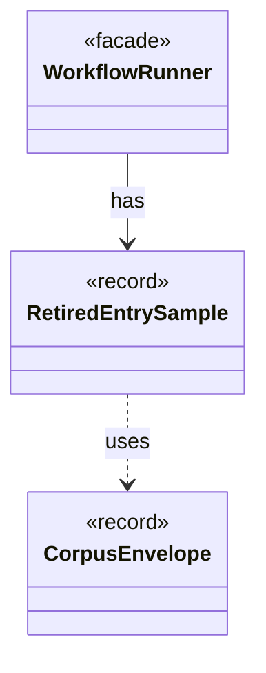

# `RetiredEntrySample`

`io.github.tlaplus.hardening.workflow` · record · other · [source](https://github.com/tlaplus/model-checker-hardening/blob/d5dcbcb332600c9312f00550a0131fd51a164e9f/src/main/java/io/github/tlaplus/hardening/workflow/RetiredEntrySample.java#L17) · module [workflow](../modules/workflow.md)

Which retired entries startup decodes (ADR 0031 §2).

**Decisions:** [ADR 0031: Sampled validation of retired entries at startup](https://github.com/tlaplus/model-checker-hardening/blob/d5dcbcb332600c9312f00550a0131fd51a164e9f/docs/decisions/0031-sampled-startup-validation.md)

The diagram draws 2 of 5 relations; the table lists them all.

| Direction | Relation | Type | Summary |
|---|---|---|---|
| ← | has | [WorkflowRunner](io.github.tlaplus.hardening.workflow.WorkflowRunner.md) | Runs generation, parsing, TLC, Apalache, conformance aggregation and the quality gate under one CPU budget. |
| → | uses | [CorpusEnvelope](io.github.tlaplus.hardening.corpus.CorpusEnvelope.md) | Supported fields decoded from one corpus input envelope. |
| → | depends | [Digests](io.github.tlaplus.hardening.common.Digests.md) | SHA-256 identities for corpus payloads and external replay dependencies. |
| → | depends | [CorpusInput](io.github.tlaplus.hardening.corpus.CorpusInput.md) | The required fields of one encoded corpus input. |
| ← | depends | [RunCommand](io.github.tlaplus.hardening.cli.RunCommand.md) | `fuzztla run`: reads a corpus configuration and runs `WorkflowRunner` with live progress output. |
