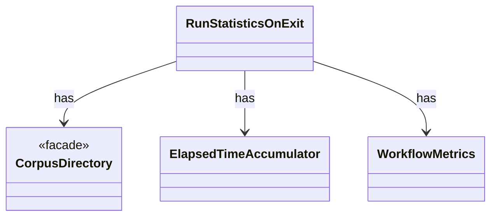

# `RunStatisticsOnExit`

`io.github.tlaplus.hardening.workflow` · class · other · [source](https://github.com/tlaplus/model-checker-hardening/blob/4df6a11e5b4bf93609393935c4cbeceec08cce0c/src/main/java/io/github/tlaplus/hardening/workflow/RunStatisticsOnExit.java#L11) · module [workflow](../modules/workflow.md)

Stops the invocation clock and saves its aggregate while the corpus lock is still held.

The diagram draws 3 of 5 relations; the table lists them all.

| Direction | Relation | Type | Summary |
|---|---|---|---|
| → | has | [CorpusDirectory](io.github.tlaplus.hardening.corpus.CorpusDirectory.md) | Owns the on-disk layout and integrity checks for one FuzzTLA corpus. |
| → | has | [ElapsedTimeAccumulator](io.github.tlaplus.hardening.workflow.execution.ElapsedTimeAccumulator.md) | Accumulates active intervals across workers using a monotonic clock. |
| → | has | [WorkflowMetrics](io.github.tlaplus.hardening.workflow.execution.WorkflowMetrics.md) | The cumulative statistics of one workflow invocation: how long each stage has been busy, what input generation has produced, and the total elapsed time carried over from earlier runs. |
| → | depends | [CorpusRunStatistics](io.github.tlaplus.hardening.corpus.CorpusRunStatistics.md) | Durable cumulative statistics that cannot be recovered cheaply from corpus entries. |
| ← | depends | [WorkflowRunner](io.github.tlaplus.hardening.workflow.WorkflowRunner.md) | Runs generation, parsing, TLC, Apalache, conformance aggregation and the quality gate under one CPU budget. |
