# `StageGraph`

`io.github.tlaplus.hardening.workflow` · class · process · key · [source](https://github.com/tlaplus/model-checker-hardening/blob/47a7fcfd71d20c6a404ebf5a8a3e7d9a0e250e9b/src/main/java/io/github/tlaplus/hardening/workflow/StageGraph.java#L58) · module [workflow](../modules/workflow.md)

The stages that run one workflow invocation, wired to their queues, result capacities, and shared collaborators, and the order in which they start and stop.

**Decisions:** [ADR 0010: Generational mutation](https://github.com/tlaplus/model-checker-hardening/blob/47a7fcfd71d20c6a404ebf5a8a3e7d9a0e250e9b/docs/decisions/0010-mutation.md)

```mermaid
classDiagram
  class StageGraph {
    <<process>>
  }
  class CorpusStage {
    <<model>>
  }
  class GenerationProgress {
    <<model>>
  }
  class AggregatorStage {
    <<process>>
  }
  class StageCounters
  class WorkQueue {
    <<utility>>
  }
  class WorkflowControl {
    <<model>>
  }
  class InputStage {
    <<process>>
  }
  class ToolStage {
    <<process>>
  }
  class GenerationLoop {
    <<process>>
  }
  class WorkflowRunner {
    <<facade>>
  }
  class FuzzTlaConfig {
    <<config>>
  }
  class MetamorphicConfig {
    <<record>>
  }
  class CheckerSet {
    <<record>>
  }
  class CorpusDirectory {
    <<facade>>
  }
  class CorpusInventory {
    <<record>>
  }
  class StageScratchSet
  class KnownDefectDatabase {
    <<facade>>
  }
  class StageVerdictSummary {
    <<record>>
  }
  class WorkflowMetrics
  class GenerationPlan {
    <<model>>
  }
  class SpecDecoders {
    <<facade>>
  }
  StageGraph --> CorpusStage : has
  StageGraph --> GenerationProgress : has
  StageGraph --> AggregatorStage : has
  StageGraph --> StageCounters : has
  StageGraph --> WorkQueue : has
  StageGraph --> WorkflowControl : has
  StageGraph --> InputStage : has
  StageGraph --> ToolStage : has
  GenerationLoop --> StageGraph : has
  WorkflowRunner --> StageGraph : has
  StageGraph ..> FuzzTlaConfig : uses
  StageGraph ..> MetamorphicConfig : uses
  StageGraph ..> CheckerSet : uses
  StageGraph ..> CorpusDirectory : uses
  StageGraph ..> CorpusInventory : uses
  StageGraph ..> StageScratchSet : uses
  StageGraph ..> KnownDefectDatabase : uses
  StageGraph ..> StageVerdictSummary : uses
  StageGraph ..> WorkflowMetrics : uses
  StageGraph ..> GenerationPlan : uses
  StageGraph ..> SpecDecoders : uses
```

The diagram draws 21 of 50 relations; the table lists them all.

| Direction | Relation | Type | Summary |
|---|---|---|---|
| → | has | [CorpusStage](io.github.tlaplus.hardening.corpus.CorpusStage.md) | One implemented stage of the fuzzing pipeline, and the corpus directories it owns. |
| → | has | [GenerationProgress](io.github.tlaplus.hardening.workflow.GenerationProgress.md) | Where every generation of a run stands, tracked from stage events instead of a corpus rescan (ADR 0010). |
| → | has | [AggregatorStage](io.github.tlaplus.hardening.workflow.aggregator.AggregatorStage.md) | Joins completed TLC and Apalache results with one in-process worker. |
| → | has | [StageCounters](io.github.tlaplus.hardening.workflow.execution.StageCounters.md) | Verdict counters for one stage, seeded from the corpus and updated by its workers. |
| → | has | [WorkQueue](io.github.tlaplus.hardening.workflow.execution.WorkQueue.md) | A close-aware multi-producer, multi-consumer queue; optionally ordered by priority. |
| → | has | [WorkflowControl](io.github.tlaplus.hardening.workflow.execution.WorkflowControl.md) | Shared stop state for independently running stages. |
| → | has | [InputStage](io.github.tlaplus.hardening.workflow.input.InputStage.md) | Concurrent input stage: admits reserved target ranges from adjacent generations. |
| → | has | [ToolStage](io.github.tlaplus.hardening.workflow.tool.ToolStage.md) | One stage that runs an external tool over corpus entries: the parser, TLC, or Apalache. |
| ← | has | [GenerationLoop](io.github.tlaplus.hardening.workflow.GenerationLoop.md) | Runs the generations of one workflow invocation over a single stage graph (ADR 0010). |
| ← | has | [WorkflowRunner](io.github.tlaplus.hardening.workflow.WorkflowRunner.md) | Runs generation, parsing, TLC, Apalache, conformance aggregation and the quality gate under one CPU budget. |
| → | uses | [FuzzTlaConfig](io.github.tlaplus.hardening.config.FuzzTlaConfig.md) | Complete configuration of input generation and workflow execution. |
| → | uses | [MetamorphicConfig](io.github.tlaplus.hardening.config.MetamorphicConfig.md) | The `[metamorphic]` table (ADR 0016 §7, ADR 0017 §1): what a `--how=mt` run reads besides the generator settings. |
| → | uses | [CheckerSet](io.github.tlaplus.hardening.corpus.CheckerSet.md) | The checker branches a corpus runs: a non-empty set of checking stages, in stage order. |
| → | uses | [CorpusDirectory](io.github.tlaplus.hardening.corpus.CorpusDirectory.md) | Owns the on-disk layout and integrity checks for one FuzzTLA corpus. |
| → | uses | [CorpusInventory](io.github.tlaplus.hardening.corpus.CorpusInventory.md) | Immutable startup inventory used to seed stage queues and capacities. |
| → | uses | [StageScratchSet](io.github.tlaplus.hardening.corpus.StageScratchSet.md) | The transient scratch directories of every stage that needs one, created and removed together. |
| → | uses | [KnownDefectDatabase](io.github.tlaplus.hardening.signature.KnownDefectDatabase.md) | The known-defect signatures of one invocation, in database order. |
| → | uses | [StageVerdictSummary](io.github.tlaplus.hardening.workflow.execution.StageVerdictSummary.md) | Cumulative verdict counters and summed worker elapsed time for one stage. |
| → | uses | [WorkflowMetrics](io.github.tlaplus.hardening.workflow.execution.WorkflowMetrics.md) | The cumulative statistics of one workflow invocation: how long each stage has been busy, what input generation has produced, and the total elapsed time carried over from earlier runs. |
| → | uses | [GenerationPlan](io.github.tlaplus.hardening.workflow.input.GenerationPlan.md) | One contiguous range of target entries the input stage admits: which input kind, for which generation, from which seed, how many entries from each candidate source, and with at most how many workers. |
| → | uses | [SpecDecoders](io.github.tlaplus.hardening.workflow.spec.SpecDecoders.md) | Immutable registry of the decoders that turn stored payloads into checkable modules. |
| → | depends | [Diagnostics](io.github.tlaplus.hardening.common.Diagnostics.md) | Human-readable diagnostic formatting for failures. |
| → | depends | [Preconditions](io.github.tlaplus.hardening.common.Preconditions.md) | Shared validation of method and constructor arguments. |
| → | depends | [CheckerStageConfig](io.github.tlaplus.hardening.config.CheckerStageConfig.md) | Capacity and resource limits for one model-checker stage. |
| → | depends | [InputStageConfig](io.github.tlaplus.hardening.config.InputStageConfig.md) | The input stage's occupancy limit and the known-defect databases its admission consults. |
| → | depends | [OperatorLibraryConfig](io.github.tlaplus.hardening.config.OperatorLibraryConfig.md) | Source-only library settings. |
| → | depends | [ParserStageConfig](io.github.tlaplus.hardening.config.ParserStageConfig.md) | Capacity and timeout limits for the parser stage. |
| → | depends | [PbtConfig](io.github.tlaplus.hardening.config.PbtConfig.md) | Limits and collection-richness controls for property-based input generation. |
| → | depends | [WorkflowConfig](io.github.tlaplus.hardening.config.WorkflowConfig.md) | Global and per-stage limits for the implemented fuzzing workflow. |
| → | depends | [CorpusException](io.github.tlaplus.hardening.corpus.CorpusException.md) | Reports an invalid corpus layout or corpus entry. |
| → | depends | [EntryName](io.github.tlaplus.hardening.corpus.EntryName.md) | The identity of one logical corpus entry: the file name it keeps in every stage directory it passes through. |
| → | depends | [StageEntryCounts](io.github.tlaplus.hardening.corpus.StageEntryCounts.md) | How many entries one stage has produced under each verdict. |
| → | depends | [CheckerBackends](io.github.tlaplus.hardening.workflow.CheckerBackends.md) | How each model-checker stage builds its backend for one invocation. |
| → | depends | [WorkflowException](io.github.tlaplus.hardening.workflow.WorkflowException.md) | Reports an infrastructure or lifecycle failure in a fuzzing workflow. |
| → | depends | [CheckerRouting](io.github.tlaplus.hardening.workflow.checker.CheckerRouting.md) | Routes a model checker's results. |
| → | depends | [CpuBudget](io.github.tlaplus.hardening.workflow.execution.CpuBudget.md) | Priority-aware logical CPU budget shared by all stage workers. |
| → | depends | [ElapsedTimeAccumulator](io.github.tlaplus.hardening.workflow.execution.ElapsedTimeAccumulator.md) | Accumulates active intervals across workers using a monotonic clock. |
| → | depends | [GeneratorStatistics](io.github.tlaplus.hardening.workflow.execution.GeneratorStatistics.md) | Cumulative input-generation counters shared by the generator workers. |
| → | depends | [OccupancyGate](io.github.tlaplus.hardening.workflow.execution.OccupancyGate.md) | Bounds the current occupancy of one stage's result directories across its workers. |
| → | depends | [StageClocks](io.github.tlaplus.hardening.workflow.execution.StageClocks.md) | One elapsed-time accumulator per corpus stage, seeded from the corpus's durable statistics. |
| → | depends | [StageEnvironment](io.github.tlaplus.hardening.workflow.execution.StageEnvironment.md) | The collaborators every stage of one workflow invocation shares: the corpus it reads and writes, the decoder each stored input kind is regenerated through, the CPU budget it competes for, and the stop state it observes and reports to. |
| → | depends | [WorkflowEvents](io.github.tlaplus.hardening.workflow.execution.WorkflowEvents.md) | Durable admission and stage transitions, reported to whatever schedules generations (ADR 0010). |
| → | depends | [WorkflowStage](io.github.tlaplus.hardening.workflow.execution.WorkflowStage.md) | An independently scheduled workflow stage that owns its worker threads. |
| → | depends | [InputAdmission](io.github.tlaplus.hardening.workflow.input.InputAdmission.md) | Decides whether a decoded candidate enters `00-inputs`, and where a known defect goes. |
| → | depends | [InputHandoff](io.github.tlaplus.hardening.workflow.input.InputHandoff.md) | How the input stage hands entries to the parser: the parser's queue, and the `00-inputs` slots that bound how many entries wait in it. |
| → | depends | [KnownDefectQuarantine](io.github.tlaplus.hardening.workflow.input.KnownDefectQuarantine.md) | Keeps at most a fixed number of quarantined candidates per primary known-defect signature in `00-known-defects`; past the cap, a match is counted by the caller and discarded here. |
| → | depends | [ParserBackend](io.github.tlaplus.hardening.workflow.parser.ParserBackend.md) | Runs SANY in persistent isolated JVMs, one per stage worker, each replaced after a crash. |
| → | depends | [ParserRouting](io.github.tlaplus.hardening.workflow.parser.ParserRouting.md) | Routes parser results. |
| → | depends | [StageRouting](io.github.tlaplus.hardening.workflow.tool.StageRouting.md) | Where a `ToolStage` takes its inputs from, how it bounds its result directories, and where a recorded result goes next. |
| → | depends | [ToolBackend](io.github.tlaplus.hardening.workflow.tool.ToolBackend.md) | Tool-specific behavior injected into the shared `ToolStage`. |
