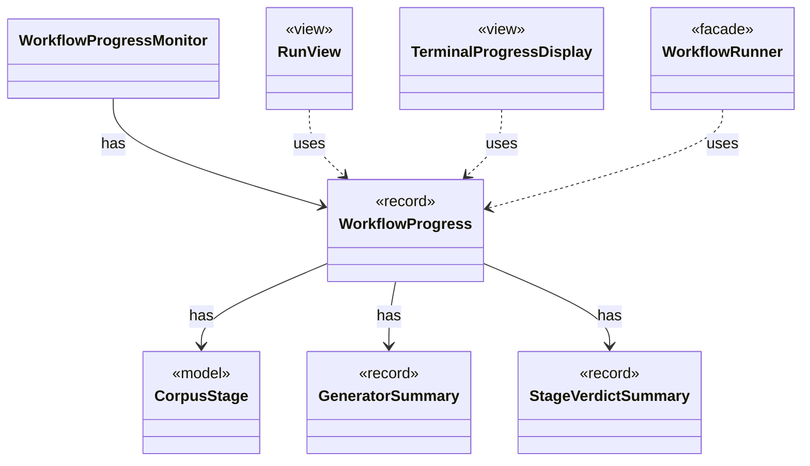

# `WorkflowProgress`

`io.github.tlaplus.hardening.workflow` · record · other · [source](https://github.com/tlaplus/model-checker-hardening/blob/0b7c167b636088dd43d36713d157e22f7ebd4f79/src/main/java/io/github/tlaplus/hardening/workflow/WorkflowProgress.java#L19) · module [workflow](../modules/workflow.md)

Best-effort snapshot of cumulative corpus statistics and current pending work.

The diagram draws 7 of 10 relations; the table lists them all.

| Direction | Relation | Type | Summary |
|---|---|---|---|
| → | has | [CorpusStage](io.github.tlaplus.hardening.corpus.CorpusStage.md) | One implemented stage of the fuzzing pipeline, and the corpus directories it owns. |
| → | has | [GeneratorSummary](io.github.tlaplus.hardening.workflow.execution.GeneratorSummary.md) | Cumulative generation statistics decorated with invocation-facing replay and timing fields. |
| → | has | [StageVerdictSummary](io.github.tlaplus.hardening.workflow.execution.StageVerdictSummary.md) | Cumulative verdict counters and summed worker elapsed time for one stage. |
| ← | has | [WorkflowProgressMonitor](io.github.tlaplus.hardening.workflow.execution.WorkflowProgressMonitor.md) | Periodically publishes serialized workflow snapshots without delaying stage workers. |
| ← | uses | [RunView](io.github.tlaplus.hardening.cli.RunView.md) | The statistics shared by live and final reports, without layout or terminal state. |
| ← | uses | [TerminalProgressDisplay](io.github.tlaplus.hardening.cli.TerminalProgressDisplay.md) | Terminal mechanics of live progress: snapshots, change highlighting, resizing, and screen restoration. |
| ← | uses | [WorkflowRunner](io.github.tlaplus.hardening.workflow.WorkflowRunner.md) | Runs generation, parsing, TLC, Apalache, conformance aggregation and the quality gate under one CPU budget. |
| → | depends | [EnumMaps](io.github.tlaplus.hardening.common.EnumMaps.md) | Validated immutable copies of maps keyed by an enum, iterated in declaration order. |
| → | depends | [Preconditions](io.github.tlaplus.hardening.common.Preconditions.md) | Shared validation of method and constructor arguments. |
| ← | depends | [RunOutput](io.github.tlaplus.hardening.cli.RunOutput.md) | The output of one run: the command's configured writer and an optional live display in front of it. |
