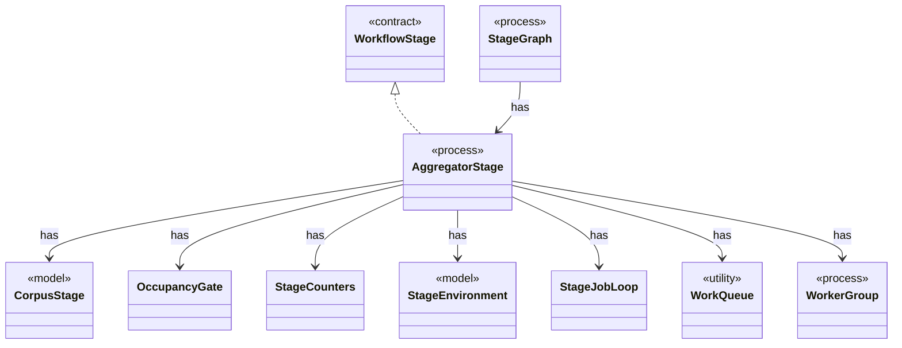

# `AggregatorStage`

`io.github.tlaplus.hardening.workflow.aggregator` · class · process · key · [source](https://github.com/tlaplus/model-checker-hardening/blob/ad025d7ad6f7113910ce3a79cf6e18839b06eb5a/src/main/java/io/github/tlaplus/hardening/workflow/aggregator/AggregatorStage.java#L30) · module [workflow](../modules/workflow.md)

Joins completed TLC and Apalache results with one in-process worker.

The diagram draws 9 of 21 relations; the table lists them all.

| Direction | Relation | Type | Summary |
|---|---|---|---|
| → | implements | [WorkflowStage](io.github.tlaplus.hardening.workflow.execution.WorkflowStage.md) | An independently scheduled workflow stage that owns its worker threads. |
| → | has | [CorpusStage](io.github.tlaplus.hardening.corpus.CorpusStage.md) | One implemented stage of the fuzzing pipeline, and the corpus directories it owns. |
| → | has | [OccupancyGate](io.github.tlaplus.hardening.workflow.execution.OccupancyGate.md) | Bounds the current occupancy of one stage's result directories across its workers. |
| → | has | [StageCounters](io.github.tlaplus.hardening.workflow.execution.StageCounters.md) | Verdict counters for one stage, seeded from the corpus and updated by its workers. |
| → | has | [StageEnvironment](io.github.tlaplus.hardening.workflow.execution.StageEnvironment.md) | The collaborators every stage of one workflow invocation shares: the corpus it reads and writes, the decoder each stored input kind is regenerated through, the CPU budget it competes for, and the stop state it observes and reports to. |
| → | has | [StageJobLoop](io.github.tlaplus.hardening.workflow.execution.StageJobLoop.md) | Claims queued items on behalf of one stage worker under the shared CPU budget. |
| → | has | [WorkQueue](io.github.tlaplus.hardening.workflow.execution.WorkQueue.md) | A close-aware multi-producer, multi-consumer queue; optionally ordered by priority. |
| → | has | [WorkerGroup](io.github.tlaplus.hardening.workflow.execution.WorkerGroup.md) | Owns the common lifecycle of a fixed group of stage worker threads. |
| ← | has | [StageGraph](io.github.tlaplus.hardening.workflow.StageGraph.md) | The stages that run one workflow invocation, wired to their queues, result capacities, and shared collaborators, and the order in which they start and stop. |
| → | depends | [Preconditions](io.github.tlaplus.hardening.common.Preconditions.md) | Shared validation of method and constructor arguments. |
| → | depends | [ThrowingConsumer](io.github.tlaplus.hardening.common.ThrowingConsumer.md) | An operation on one value that may fail with a checked exception. |
| → | depends | [ThrowingRunnable](io.github.tlaplus.hardening.common.ThrowingRunnable.md) | An operation that takes no value and may fail with a checked exception. |
| → | depends | [AggregationInput](io.github.tlaplus.hardening.corpus.AggregationInput.md) | A logical corpus entry whose non-crash checker results are ready for aggregation. |
| → | depends | [CorpusDirectory](io.github.tlaplus.hardening.corpus.CorpusDirectory.md) | Owns the on-disk layout and integrity checks for one FuzzTLA corpus. |
| → | depends | [CorpusVerdict](io.github.tlaplus.hardening.corpus.CorpusVerdict.md) | A verdict supported by the implemented corpus stages. |
| → | depends | [EntryName](io.github.tlaplus.hardening.corpus.EntryName.md) | The identity of one logical corpus entry: the file name it keeps in every stage directory it passes through. |
| → | depends | [StageResult](io.github.tlaplus.hardening.corpus.StageResult.md) | What one stage decided about one input, and the tool output kept for triage. |
| → | depends | [CpuBudget](io.github.tlaplus.hardening.workflow.execution.CpuBudget.md) | Priority-aware logical CPU budget shared by all stage workers. |
| → | depends | [StageWorker](io.github.tlaplus.hardening.workflow.execution.StageWorker.md) | Runs one stage worker, turning its interruption or failure into shared stop state. |
| → | depends | [WorkflowControl](io.github.tlaplus.hardening.workflow.execution.WorkflowControl.md) | Shared stop state for independently running stages. |
| → | depends | [WorkflowEvents](io.github.tlaplus.hardening.workflow.execution.WorkflowEvents.md) | Durable admission and stage transitions, reported to whatever schedules generations (ADR 0010). |
