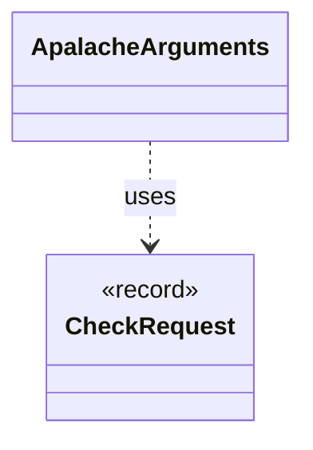

# `ApalacheArguments`

`io.github.tlaplus.hardening.workflow.apalache` · class · other · [source](https://github.com/tlaplus/model-checker-hardening/blob/47a7fcfd71d20c6a404ebf5a8a3e7d9a0e250e9b/src/main/java/io/github/tlaplus/hardening/workflow/apalache/ApalacheArguments.java#L9) · module [workflow](../modules/workflow.md)

The Apalache command line for one checked module.

The diagram draws 1 of 3 relations; the table lists them all.

| Direction | Relation | Type | Summary |
|---|---|---|---|
| → | uses | [CheckRequest](io.github.tlaplus.hardening.workflow.worker.CheckRequest.md) | What a checker is asked about one assembled module. |
| → | depends | [FuzzInputModule](io.github.tlaplus.hardening.workflow.spec.FuzzInputModule.md) | Assembles the module checked by the parser and model-checker stages. |
| ← | depends | [ApalacheWorkerMain](io.github.tlaplus.hardening.workflow.apalache.ApalacheWorkerMain.md) | Persistent child process that invokes Apalache's `Tool.run` sequentially. |
