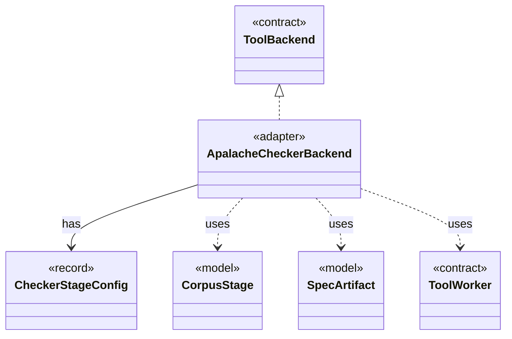

# `ApalacheCheckerBackend`

`io.github.tlaplus.hardening.workflow.apalache` · class · adapter · key · [source](https://github.com/tlaplus/model-checker-hardening/blob/3df8c8564b58e946b95079b671788c8315f98831/src/main/java/io/github/tlaplus/hardening/workflow/apalache/ApalacheCheckerBackend.java#L18) · module [workflow](../modules/workflow.md)

Adapts persistent Apalache tool workers to the shared tool stage.

The diagram draws 5 of 10 relations; the table lists them all.

| Direction | Relation | Type | Summary |
|---|---|---|---|
| → | implements | [ToolBackend](io.github.tlaplus.hardening.workflow.tool.ToolBackend.md) | Tool-specific behavior injected into the shared `ToolStage`. |
| → | has | [CheckerStageConfig](io.github.tlaplus.hardening.config.CheckerStageConfig.md) | Capacity and resource limits for one model-checker stage. |
| → | uses | [CorpusStage](io.github.tlaplus.hardening.corpus.CorpusStage.md) | One implemented stage of the fuzzing pipeline, and the corpus directories it owns. |
| → | uses | [SpecArtifact](io.github.tlaplus.hardening.workflow.spec.SpecArtifact.md) | One assembled module, what its checkers are asked about it, and what its decoder produced. |
| → | uses | [ToolWorker](io.github.tlaplus.hardening.workflow.tool.ToolWorker.md) | Worker-local tool state used for one or more sequential inputs. |
| → | depends | [WorkflowException](io.github.tlaplus.hardening.workflow.WorkflowException.md) | Reports an infrastructure or lifecycle failure in a fuzzing workflow. |
| → | depends | [ApalacheFailureDetail](io.github.tlaplus.hardening.workflow.apalache.ApalacheFailureDetail.md) | Extracts bounded human-readable context from Apalache diagnostics. |
| → | depends | [ApalacheIrJson](io.github.tlaplus.hardening.workflow.apalache.ApalacheIrJson.md) | Renders an assembled module as the typed Apalache IR JSON that Apalache consumes. |
| → | depends | [ApalacheProcess](io.github.tlaplus.hardening.workflow.apalache.ApalacheProcess.md) | Starts one persistent isolated Apalache JVM, which serves inputs until a crash retires it. |
| ← | depends | [CheckerBackends](io.github.tlaplus.hardening.workflow.CheckerBackends.md) | How each model-checker stage builds its backend for one invocation. |
