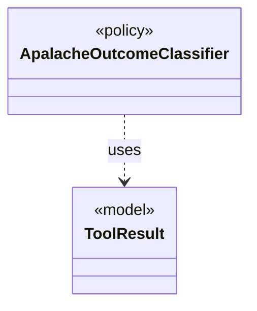

# `ApalacheOutcomeClassifier`

`io.github.tlaplus.hardening.workflow.apalache` · class · policy · key · [source](https://github.com/tlaplus/model-checker-hardening/blob/0b7c167b636088dd43d36713d157e22f7ebd4f79/src/main/java/io/github/tlaplus/hardening/workflow/apalache/ApalacheOutcomeClassifier.java#L13) · module [workflow](../modules/workflow.md)

Maps Apalache tool exit statuses to shared workflow outcomes.

The diagram draws 1 of 6 relations; the table lists them all.

| Direction | Relation | Type | Summary |
|---|---|---|---|
| → | uses | [ToolResult](io.github.tlaplus.hardening.workflow.worker.ToolResult.md) | One request result returned by an isolated tool worker. |
| → | depends | [CheckerFailureCode](io.github.tlaplus.hardening.checker.CheckerFailureCode.md) | Stable failure codes shared by model-checker stages. |
| → | depends | [StageOutcome](io.github.tlaplus.hardening.workflow.worker.StageOutcome.md) | Common result of processing one input in a checking stage. |
| → | depends | [WorkerDiagnostics](io.github.tlaplus.hardening.workflow.worker.WorkerDiagnostics.md) | Diagnostic formatting shared by isolated tool entry points. |
| ← | depends | [ApalacheFailureDetail](io.github.tlaplus.hardening.workflow.apalache.ApalacheFailureDetail.md) | Extracts bounded human-readable context from Apalache diagnostics. |
| ← | depends | [ApalacheWorkerMain](io.github.tlaplus.hardening.workflow.apalache.ApalacheWorkerMain.md) | Persistent child process that invokes Apalache's `Tool.run` sequentially. |
