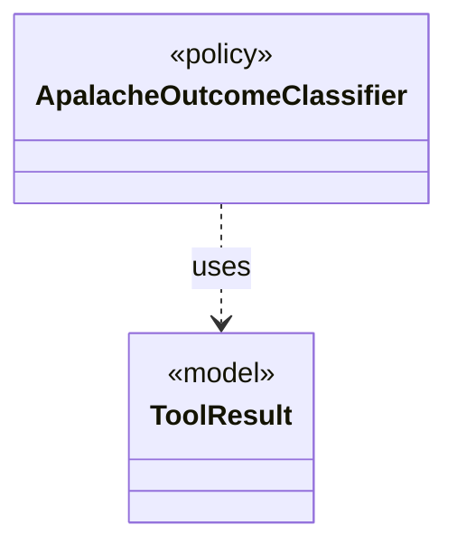

# `ApalacheOutcomeClassifier`

`io.github.tlaplus.hardening.workflow.apalache` · class · policy · key · [source](https://github.com/tlaplus/model-checker-hardening/blob/d4b229fc7366469558e1c11dfe92890fdc0a5049/src/main/java/io/github/tlaplus/hardening/workflow/apalache/ApalacheOutcomeClassifier.java#L16) · module [workflow](../modules/workflow.md)

Maps Apalache tool exit statuses to shared workflow outcomes, for Apalache and for a generic checker that follows Apalache's exit statuses (ADR 0033 §2).

**Decisions:** [ADR 0033: A generic checker for TLC- and Apalache-compatible tools](https://github.com/tlaplus/model-checker-hardening/blob/d4b229fc7366469558e1c11dfe92890fdc0a5049/docs/decisions/0033-generic-checker.md)

The diagram draws 1 of 7 relations; the table lists them all.

| Direction | Relation | Type | Summary |
|---|---|---|---|
| → | uses | [ToolResult](io.github.tlaplus.hardening.workflow.worker.ToolResult.md) | One request result returned by an isolated tool worker. |
| → | depends | [CheckerFailureCode](io.github.tlaplus.hardening.checker.CheckerFailureCode.md) | Stable failure codes shared by model-checker stages. |
| → | depends | [Diagnostics](io.github.tlaplus.hardening.common.Diagnostics.md) | Human-readable diagnostic formatting for failures. |
| → | depends | [StageOutcome](io.github.tlaplus.hardening.workflow.worker.StageOutcome.md) | Common result of processing one input in a checking stage. |
| ← | depends | [ApalacheFailureDetail](io.github.tlaplus.hardening.workflow.apalache.ApalacheFailureDetail.md) | Extracts bounded human-readable context from Apalache diagnostics. |
| ← | depends | [ApalacheWorkerMain](io.github.tlaplus.hardening.workflow.apalache.ApalacheWorkerMain.md) | Persistent child process that invokes Apalache's `Tool.run` sequentially. |
| ← | depends | [GenericConvention](io.github.tlaplus.hardening.workflow.generic.GenericConvention.md) | What a compatibility means to the generic checker (ADR 0033 §2): the configuration file written as `{config}`, how an exit status becomes a verdict, and which exploration metrics the tool's output gives (§5). |
