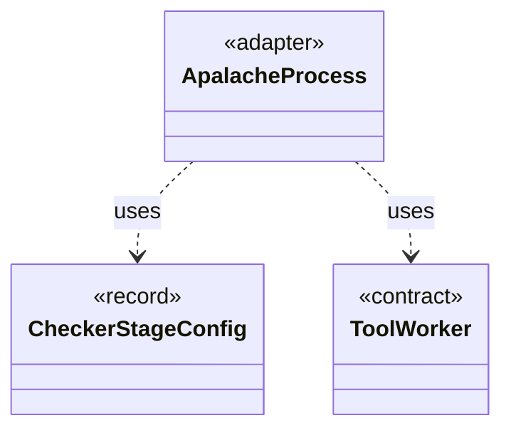

# `ApalacheProcess`

`io.github.tlaplus.hardening.workflow.apalache` · class · adapter · key · [source](https://github.com/tlaplus/model-checker-hardening/blob/e180a3892e661e5d7ba7636c4f24a6fca66ded14/src/main/java/io/github/tlaplus/hardening/workflow/apalache/ApalacheProcess.java#L20) · module [workflow](../modules/workflow.md)

Starts one persistent isolated Apalache JVM, which serves inputs until a crash retires it.

The diagram draws 2 of 10 relations; the table lists them all.

| Direction | Relation | Type | Summary |
|---|---|---|---|
| → | uses | [CheckerStageConfig](io.github.tlaplus.hardening.config.CheckerStageConfig.md) | Capacity and resource limits for one model-checker stage. |
| → | uses | [ToolWorker](io.github.tlaplus.hardening.workflow.tool.ToolWorker.md) | Worker-local tool state used for one or more sequential inputs. |
| → | depends | [WorkflowException](io.github.tlaplus.hardening.workflow.WorkflowException.md) | Reports an infrastructure or lifecycle failure in a fuzzing workflow. |
| → | depends | [ApalacheWorkerMain](io.github.tlaplus.hardening.workflow.apalache.ApalacheWorkerMain.md) | Persistent child process that invokes Apalache's `Tool.run` sequentially. |
| → | depends | [ProcessToolWorker](io.github.tlaplus.hardening.workflow.tool.ProcessToolWorker.md) | A tool worker served by one isolated child process until a crash verdict retires it. |
| → | depends | [ChildJvm](io.github.tlaplus.hardening.workflow.worker.ChildJvm.md) | The resources and options of one child JVM. |
| → | depends | [IsolatedWorkerProcess](io.github.tlaplus.hardening.workflow.worker.IsolatedWorkerProcess.md) | Parent-side supervisor for one isolated Java tool worker. |
| → | depends | [JavaLaunch](io.github.tlaplus.hardening.workflow.worker.JavaLaunch.md) | How this project spells a child JVM launch, so every caller spells it the same way. |
| → | depends | [WorkerSpec](io.github.tlaplus.hardening.workflow.worker.WorkerSpec.md) | How to launch one isolated tool worker: where it may write, how long it may take to come up, which class it runs, what goes in front of this JVM's class path, the child JVM it runs in, and what to call it in diagnostics. |
| ← | depends | [ApalacheCheckerBackend](io.github.tlaplus.hardening.workflow.apalache.ApalacheCheckerBackend.md) | Adapts persistent Apalache tool workers to the shared tool stage. |
