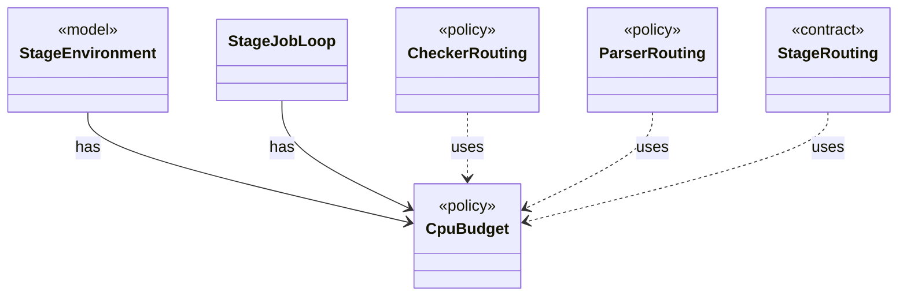

# `CpuBudget`

`io.github.tlaplus.hardening.workflow.execution` · class · policy · key · [source](https://github.com/tlaplus/model-checker-hardening/blob/3df8c8564b58e946b95079b671788c8315f98831/src/main/java/io/github/tlaplus/hardening/workflow/execution/CpuBudget.java#L23) · module [workflow](../modules/workflow.md)

Priority-aware logical CPU budget shared by all stage workers.

**Decisions:** [ADR 0010: Generational mutation](https://github.com/tlaplus/model-checker-hardening/blob/3df8c8564b58e946b95079b671788c8315f98831/docs/decisions/0010-mutation.md)

The diagram draws 5 of 10 relations; the table lists them all.

| Direction | Relation | Type | Summary |
|---|---|---|---|
| ← | has | [StageEnvironment](io.github.tlaplus.hardening.workflow.execution.StageEnvironment.md) | The collaborators every stage of one workflow invocation shares: the corpus it reads and writes, the decoder each stored input kind is regenerated through, the CPU budget it competes for, and the stop state it observes and reports to. |
| ← | has | [StageJobLoop](io.github.tlaplus.hardening.workflow.execution.StageJobLoop.md) | Claims queued items on behalf of one stage worker under the shared CPU budget. |
| ← | uses | [CheckerRouting](io.github.tlaplus.hardening.workflow.checker.CheckerRouting.md) | Routes a model checker's results. |
| ← | uses | [ParserRouting](io.github.tlaplus.hardening.workflow.parser.ParserRouting.md) | Routes parser results. |
| ← | uses | [StageRouting](io.github.tlaplus.hardening.workflow.tool.StageRouting.md) | Where a `ToolStage` takes its inputs from, how it bounds its result directories, and where a recorded result goes next. |
| → | depends | [Preconditions](io.github.tlaplus.hardening.common.Preconditions.md) | Shared validation of method and constructor arguments. |
| ← | depends | [StageGraph](io.github.tlaplus.hardening.workflow.StageGraph.md) | The stages that run one workflow invocation, wired to their queues, result capacities, and shared collaborators, and the order in which they start and stop. |
| ← | depends | [AggregatorStage](io.github.tlaplus.hardening.workflow.aggregator.AggregatorStage.md) | Joins completed TLC and Apalache results with one in-process worker. |
| ← | depends | [InputStage](io.github.tlaplus.hardening.workflow.input.InputStage.md) | Concurrent input stage: admits reserved target ranges from adjacent generations. |
| ← | depends | [ToolStage](io.github.tlaplus.hardening.workflow.tool.ToolStage.md) | One stage that runs an external tool over corpus entries: the parser, TLC, or Apalache. |
