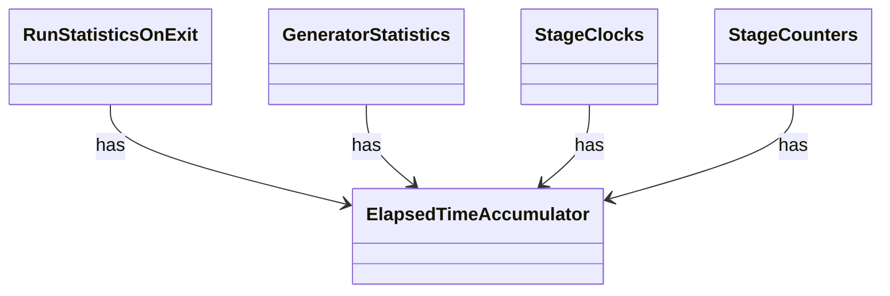

# `ElapsedTimeAccumulator`

`io.github.tlaplus.hardening.workflow.execution` · class · other · [source](https://github.com/tlaplus/model-checker-hardening/blob/6bd7d927f1cffd7642029a3d925dff47091ddde9/src/main/java/io/github/tlaplus/hardening/workflow/execution/ElapsedTimeAccumulator.java#L10) · module [workflow](../modules/workflow.md)

Accumulates active intervals across workers using a monotonic clock.

The diagram draws 4 of 11 relations; the table lists them all.

| Direction | Relation | Type | Summary |
|---|---|---|---|
| ← | has | [RunStatisticsOnExit](io.github.tlaplus.hardening.workflow.RunStatisticsOnExit.md) | Stops the invocation clock and saves its aggregate while the corpus lock is still held. |
| ← | has | [GeneratorStatistics](io.github.tlaplus.hardening.workflow.execution.GeneratorStatistics.md) | Cumulative input-generation counters shared by the generator workers. |
| ← | has | [StageClocks](io.github.tlaplus.hardening.workflow.execution.StageClocks.md) | One elapsed-time accumulator per corpus stage, seeded from the corpus's durable statistics. |
| ← | has | [StageCounters](io.github.tlaplus.hardening.workflow.execution.StageCounters.md) | Verdict counters for one stage, seeded from the corpus and updated by its workers. |
| → | depends | [Preconditions](io.github.tlaplus.hardening.common.Preconditions.md) | Shared validation of method and constructor arguments. |
| ← | depends | [StageGraph](io.github.tlaplus.hardening.workflow.StageGraph.md) | The stages that run one workflow invocation, wired to their queues, result capacities, and shared collaborators, and the order in which they start and stop. |
| ← | depends | [WorkflowRunner](io.github.tlaplus.hardening.workflow.WorkflowRunner.md) | Runs generation, parsing, TLC, Apalache, conformance aggregation and the quality gate under one CPU budget. |
| ← | depends | [StageJobLoop](io.github.tlaplus.hardening.workflow.execution.StageJobLoop.md) | Claims queued items on behalf of one stage worker under the shared CPU budget. |
| ← | depends | [WorkflowMetrics](io.github.tlaplus.hardening.workflow.execution.WorkflowMetrics.md) | The cumulative statistics of one workflow invocation: how long each stage has been busy, what input generation has produced, and the total elapsed time carried over from earlier runs. |
| ← | depends | [InputStage](io.github.tlaplus.hardening.workflow.input.InputStage.md) | Concurrent input stage: admits reserved target ranges from adjacent generations. |
| ← | depends | [QualityGate](io.github.tlaplus.hardening.workflow.quality.QualityGate.md) | Selects the parents of the next generation from one settled generation (ADR 0010, ADR 0013). |
