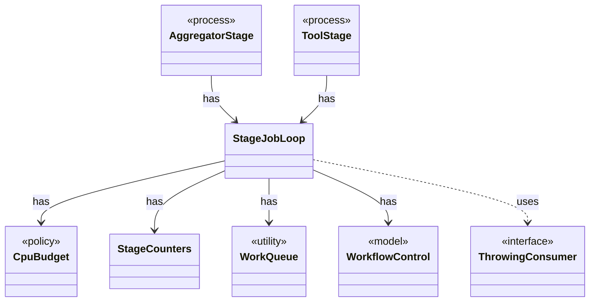

# `StageJobLoop`

`io.github.tlaplus.hardening.workflow.execution` · class · other · [source](https://github.com/tlaplus/model-checker-hardening/blob/e180a3892e661e5d7ba7636c4f24a6fca66ded14/src/main/java/io/github/tlaplus/hardening/workflow/execution/StageJobLoop.java#L15) · module [workflow](../modules/workflow.md)

Claims queued items on behalf of one stage worker under the shared CPU budget.

The diagram draws 7 of 9 relations; the table lists them all.

| Direction | Relation | Type | Summary |
|---|---|---|---|
| → | has | [CpuBudget](io.github.tlaplus.hardening.workflow.execution.CpuBudget.md) | Priority-aware logical CPU budget shared by all stage workers. |
| → | has | [StageCounters](io.github.tlaplus.hardening.workflow.execution.StageCounters.md) | Verdict counters for one stage, seeded from the corpus and updated by its workers. |
| → | has | [WorkQueue](io.github.tlaplus.hardening.workflow.execution.WorkQueue.md) | A close-aware multi-producer, multi-consumer queue; optionally ordered by priority. |
| → | has | [WorkflowControl](io.github.tlaplus.hardening.workflow.execution.WorkflowControl.md) | Shared stop state for independently running stages. |
| ← | has | [AggregatorStage](io.github.tlaplus.hardening.workflow.aggregator.AggregatorStage.md) | Joins completed TLC and Apalache results with one in-process worker. |
| ← | has | [ToolStage](io.github.tlaplus.hardening.workflow.tool.ToolStage.md) | One stage that runs an external tool over corpus entries: the parser, TLC, or Apalache. |
| → | uses | [ThrowingConsumer](io.github.tlaplus.hardening.common.ThrowingConsumer.md) | An operation on one value that may fail with a checked exception. |
| → | depends | [Preconditions](io.github.tlaplus.hardening.common.Preconditions.md) | Shared validation of method and constructor arguments. |
| → | depends | [ElapsedTimeAccumulator](io.github.tlaplus.hardening.workflow.execution.ElapsedTimeAccumulator.md) | Accumulates active intervals across workers using a monotonic clock. |
