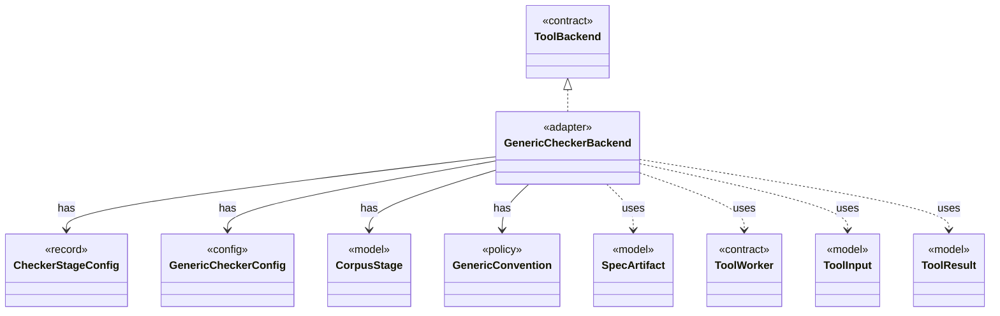

# `GenericCheckerBackend`

`io.github.tlaplus.hardening.workflow.generic` · class · adapter · key · [source](https://github.com/tlaplus/model-checker-hardening/blob/b1d642d707df18a7597ce87d7e826c837e78f842/src/main/java/io/github/tlaplus/hardening/workflow/generic/GenericCheckerBackend.java#L40) · module [workflow](../modules/workflow.md)

Runs the generic checker of ADR 0033 as one native process per input, the lifecycle `ToolBackend` describes for TLC, but without a JVM.

**Decisions:** [ADR 0033: A generic checker for TLC- and Apalache-compatible tools](https://github.com/tlaplus/model-checker-hardening/blob/b1d642d707df18a7597ce87d7e826c837e78f842/docs/decisions/0033-generic-checker.md)

The diagram draws 9 of 26 relations; the table lists them all.

| Direction | Relation | Type | Summary |
|---|---|---|---|
| → | implements | [ToolBackend](io.github.tlaplus.hardening.workflow.tool.ToolBackend.md) | Tool-specific behavior injected into the shared `ToolStage`. |
| → | has | [CheckerStageConfig](io.github.tlaplus.hardening.config.CheckerStageConfig.md) | Capacity and resource limits for one model-checker stage. |
| → | has | [GenericCheckerConfig](io.github.tlaplus.hardening.config.GenericCheckerConfig.md) | The `[generic]` table (ADR 0033 §1): a model checker that claims compatibility with TLC or Apalache, run as a native process for each input. |
| → | has | [CorpusStage](io.github.tlaplus.hardening.corpus.CorpusStage.md) | One implemented stage of the fuzzing pipeline, and the corpus directories it owns. |
| → | has | [GenericConvention](io.github.tlaplus.hardening.workflow.generic.GenericConvention.md) | What a compatibility means to the generic checker (ADR 0033 §2): the configuration file written as `{config}`, how an exit status becomes a verdict, and which exploration metrics the tool's output gives (§5). |
| → | uses | [SpecArtifact](io.github.tlaplus.hardening.workflow.spec.SpecArtifact.md) | One assembled module, what its checkers are asked about it, and what its decoder produced. |
| → | uses | [ToolWorker](io.github.tlaplus.hardening.workflow.tool.ToolWorker.md) | Worker-local tool state used for one or more sequential inputs. |
| → | uses | [ToolInput](io.github.tlaplus.hardening.workflow.worker.ToolInput.md) | One rendered specification and what the receiving checker is asked about it. |
| → | uses | [ToolResult](io.github.tlaplus.hardening.workflow.worker.ToolResult.md) | One request result returned by an isolated tool worker. |
| → | depends | [Diagnostics](io.github.tlaplus.hardening.common.Diagnostics.md) | Human-readable diagnostic formatting for failures. |
| → | depends | [FileTrees](io.github.tlaplus.hardening.common.FileTrees.md) | File-tree operations shared by the corpus and by isolated worker processes. |
| → | depends | [Preconditions](io.github.tlaplus.hardening.common.Preconditions.md) | Shared validation of method and constructor arguments. |
| → | depends | [GenericCapabilities](io.github.tlaplus.hardening.config.GenericCapabilities.md) | What a generic checker supports of the reference checker's conventions (ADR 0033 §7, §8). |
| → | depends | [GenericCompatibility](io.github.tlaplus.hardening.config.GenericCompatibility.md) | The reference checker whose conventions a generic checker follows (ADR 0033 §2): the configuration file FuzzTLA writes for it and how its exit status becomes a verdict. |
| → | depends | [GenericErrors](io.github.tlaplus.hardening.config.GenericErrors.md) | How much of a generic checker's exit status the aggregator compares (ADR 0033 §7). |
| → | depends | [GenericPlaceholder](io.github.tlaplus.hardening.config.GenericPlaceholder.md) | A placeholder in `[generic] arguments` (ADR 0033 §3), written `{name}`. |
| → | depends | [WorkflowException](io.github.tlaplus.hardening.workflow.WorkflowException.md) | Reports an infrastructure or lifecycle failure in a fuzzing workflow. |
| → | depends | [ApalacheIrJson](io.github.tlaplus.hardening.workflow.apalache.ApalacheIrJson.md) | Renders an assembled module as the typed Apalache IR JSON that Apalache consumes. |
| → | depends | [GenericInvocation](io.github.tlaplus.hardening.workflow.generic.GenericInvocation.md) | The files and the command line of one generic checker invocation in its working directory (ADR 0033 §3, §4). |
| → | depends | [SpecText](io.github.tlaplus.hardening.workflow.spec.SpecText.md) | Renders an assembled module as the TLA+ source that the parser and TLC consume. |
| → | depends | [PropertyRunsVerdict](io.github.tlaplus.hardening.workflow.tool.PropertyRunsVerdict.md) | Folds the relation run of a metamorphic module and its two property runs into the one outcome of a checker stage (ADR 0027 §4, ADR 0029 §1). |
| → | depends | [CheckKind](io.github.tlaplus.hardening.workflow.worker.CheckKind.md) | What one checker invocation checks in an assembled module: which side's specification it explores, and whether it checks the invariant, the action invariant of a metamorphic module and a temporal property. |
| → | depends | [CheckRequest](io.github.tlaplus.hardening.workflow.worker.CheckRequest.md) | What a checker is asked about one assembled module. |
| → | depends | [OneShotTool](io.github.tlaplus.hardening.workflow.worker.OneShotTool.md) | A finite CLI invocation, unlike protocol workers which serve a sequence of per-input requests. |
| → | depends | [StageOutcome](io.github.tlaplus.hardening.workflow.worker.StageOutcome.md) | Common result of processing one input in a checking stage. |
| ← | depends | [CheckerBackends](io.github.tlaplus.hardening.workflow.CheckerBackends.md) | How each model-checker stage builds its backend for one invocation. |
