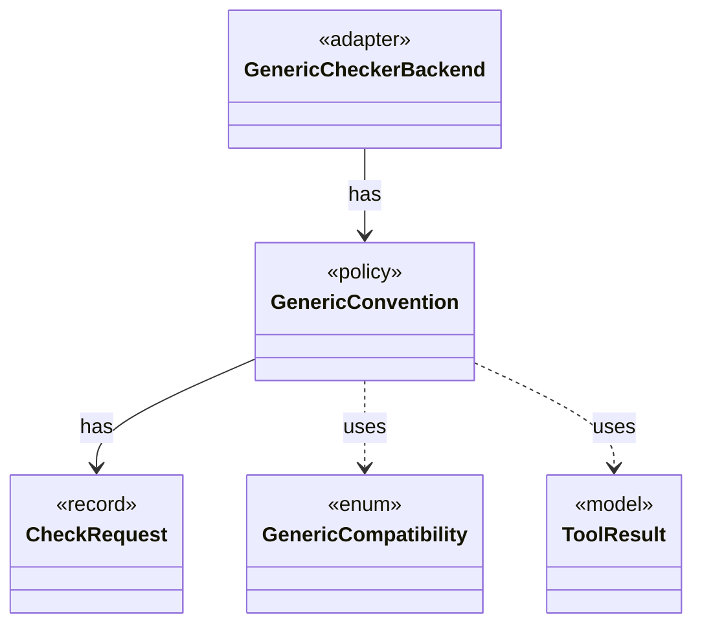

# `GenericConvention`

`io.github.tlaplus.hardening.workflow.generic` · record · policy · key · [source](https://github.com/tlaplus/model-checker-hardening/blob/390ea420071a36987998dbae4a6bab1d394188dc/src/main/java/io/github/tlaplus/hardening/workflow/generic/GenericConvention.java#L28) · module [workflow](../modules/workflow.md)

What a compatibility means to the generic checker (ADR 0033 §2): the configuration file written as `{config}`, and how an exit status becomes a verdict.

**Decisions:** [ADR 0033: A generic checker for TLC- and Apalache-compatible tools](https://github.com/tlaplus/model-checker-hardening/blob/390ea420071a36987998dbae4a6bab1d394188dc/docs/decisions/0033-generic-checker.md)

The diagram draws 4 of 10 relations; the table lists them all.

| Direction | Relation | Type | Summary |
|---|---|---|---|
| → | has | [CheckRequest](io.github.tlaplus.hardening.workflow.worker.CheckRequest.md) | What a checker is asked about one assembled module. |
| ← | has | [GenericCheckerBackend](io.github.tlaplus.hardening.workflow.generic.GenericCheckerBackend.md) | Runs the generic checker of ADR 0033 as one native process per input, the lifecycle `ToolBackend` describes for TLC, but without a JVM. |
| → | uses | [GenericCompatibility](io.github.tlaplus.hardening.config.GenericCompatibility.md) | The reference checker whose conventions a generic checker follows (ADR 0033 §2): the configuration file FuzzTLA writes for it and how its exit status becomes a verdict. |
| → | uses | [ToolResult](io.github.tlaplus.hardening.workflow.worker.ToolResult.md) | One request result returned by an isolated tool worker. |
| → | depends | [ApalacheArguments](io.github.tlaplus.hardening.workflow.apalache.ApalacheArguments.md) | The Apalache command line for one checked module. |
| → | depends | [ApalacheOutcomeClassifier](io.github.tlaplus.hardening.workflow.apalache.ApalacheOutcomeClassifier.md) | Maps Apalache tool exit statuses to shared workflow outcomes, for Apalache and for a generic checker that follows Apalache's exit statuses (ADR 0033 §2). |
| → | depends | [FuzzInputModule](io.github.tlaplus.hardening.workflow.spec.FuzzInputModule.md) | Assembles the module checked by the parser and model-checker stages. |
| → | depends | [TlcConfiguration](io.github.tlaplus.hardening.workflow.tlc.TlcConfiguration.md) | The TLC configuration file for one checked module. |
| → | depends | [TlcOutcomeClassifier](io.github.tlaplus.hardening.workflow.tlc.TlcOutcomeClassifier.md) | Maps TLC's internal error constants and exit statuses to workflow outcomes, for TLC and for a generic checker that follows TLC's exit statuses (ADR 0033 §2). |
| → | depends | [CheckKind](io.github.tlaplus.hardening.workflow.worker.CheckKind.md) | What one checker invocation checks in an assembled module: which side's specification it explores, and whether it checks the invariant, the action invariant of a metamorphic module and a temporal property. |
