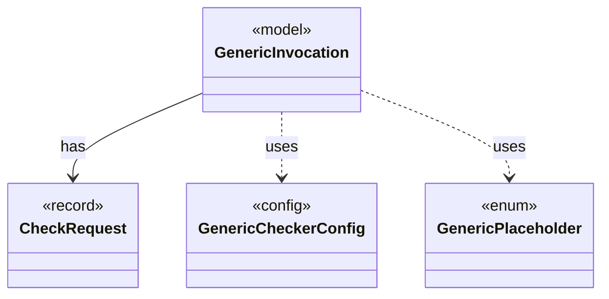

# `GenericInvocation`

`io.github.tlaplus.hardening.workflow.generic` · record · model · [source](https://github.com/tlaplus/model-checker-hardening/blob/fa5b6c03c36b49df3e797d3e6300c7eb0fea3a6b/src/main/java/io/github/tlaplus/hardening/workflow/generic/GenericInvocation.java#L24) · module [workflow](../modules/workflow.md)

The files and the command line of one generic checker invocation in its working directory (ADR 0033 §3, §4).

**Decisions:** [ADR 0033: A generic checker for TLC- and Apalache-compatible tools](https://github.com/tlaplus/model-checker-hardening/blob/fa5b6c03c36b49df3e797d3e6300c7eb0fea3a6b/docs/decisions/0033-generic-checker.md)

The diagram draws 3 of 7 relations; the table lists them all.

| Direction | Relation | Type | Summary |
|---|---|---|---|
| → | has | [CheckRequest](io.github.tlaplus.hardening.workflow.worker.CheckRequest.md) | What a checker is asked about one assembled module. |
| → | uses | [GenericCheckerConfig](io.github.tlaplus.hardening.config.GenericCheckerConfig.md) | The `[generic]` table (ADR 0033 §1): a model checker that claims compatibility with TLC or Apalache, run as a native process for each input. |
| → | uses | [GenericPlaceholder](io.github.tlaplus.hardening.config.GenericPlaceholder.md) | A placeholder in `[generic] arguments` (ADR 0033 §3), written `{name}`. |
| → | depends | [ApalacheArguments](io.github.tlaplus.hardening.workflow.apalache.ApalacheArguments.md) | The Apalache command line for one checked module. |
| → | depends | [FuzzInputModule](io.github.tlaplus.hardening.workflow.spec.FuzzInputModule.md) | Assembles the module checked by the parser and model-checker stages. |
| → | depends | [CheckKind](io.github.tlaplus.hardening.workflow.worker.CheckKind.md) | What one checker invocation checks in an assembled module: which side's specification it explores, and whether it checks the invariant, the action invariant of a metamorphic module and a temporal property. |
| ← | depends | [GenericCheckerBackend](io.github.tlaplus.hardening.workflow.generic.GenericCheckerBackend.md) | Runs the generic checker of ADR 0033 as one native process per input, the lifecycle `ToolBackend` describes for TLC, but without a JVM. |
