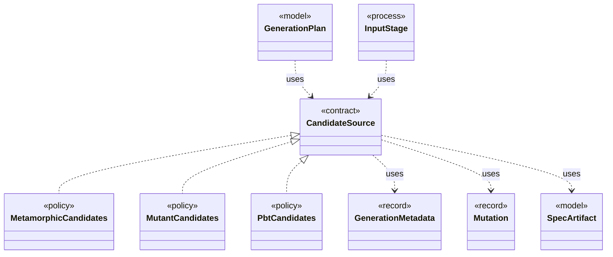

# `CandidateSource`

`io.github.tlaplus.hardening.workflow.input` · interface · contract · key · [source](https://github.com/tlaplus/model-checker-hardening/blob/af09a9e32eb710979ef0c76f29507ce1ffe85a15/src/main/java/io/github/tlaplus/hardening/workflow/input/CandidateSource.java#L21) · module [workflow](../modules/workflow.md)

Where the candidates for a target entry of the input stage come from: property-based generation or mutation of a selected parent (ADR 0010).

**Decisions:** [ADR 0010: Generational mutation](https://github.com/tlaplus/model-checker-hardening/blob/af09a9e32eb710979ef0c76f29507ce1ffe85a15/docs/decisions/0010-mutation.md)

The diagram draws 8 of 9 relations; the table lists them all.

| Direction | Relation | Type | Summary |
|---|---|---|---|
| ← | implements | [MetamorphicCandidates](io.github.tlaplus.hardening.workflow.input.MetamorphicCandidates.md) | Adopts elite conformance entries (ADR 0016 §6): every candidate is the payload of a uniformly drawn parent of a pbt corpus behind the metamorphic header, followed by random rewrite bytes. |
| ← | implements | [MutantCandidates](io.github.tlaplus.hardening.workflow.input.MutantCandidates.md) | Mutants of the parent pool (ADR 0010): every candidate mutates a uniformly drawn parent, keeps its cohort, and is rejected as a clone when it renders to the parent's module. |
| ← | implements | [PbtCandidates](io.github.tlaplus.hardening.workflow.input.PbtCandidates.md) | Property-based candidates (ADR 0002): a target draws one richness cohort, and every candidate for it is a uniformly random byte array of a length from `InputLengthSampler`. |
| → | uses | [GenerationMetadata](io.github.tlaplus.hardening.corpus.GenerationMetadata.md) | Admission-time facts about one corpus input: the generation that admitted it, its PBT cohort and collection-richness score, and, for a mutant, the parent and operators it was derived from. |
| → | uses | [Mutation](io.github.tlaplus.hardening.corpus.Mutation.md) | How a mutated input was derived: the digest of the parent it was mutated from and the operators applied to the parent, in order. |
| → | uses | [SpecArtifact](io.github.tlaplus.hardening.workflow.spec.SpecArtifact.md) | One assembled module, what its checkers are asked about it, and what its decoder produced. |
| ← | uses | [GenerationPlan](io.github.tlaplus.hardening.workflow.input.GenerationPlan.md) | One contiguous range of target entries the input stage admits: which input kind, for which generation, from which seed, how many entries from each candidate source, and with at most how many workers. |
| ← | uses | [InputStage](io.github.tlaplus.hardening.workflow.input.InputStage.md) | Concurrent input stage: admits reserved target ranges from adjacent generations. |
| ← | depends | [GenerationLoop](io.github.tlaplus.hardening.workflow.GenerationLoop.md) | Runs the generations of one workflow invocation over a single stage graph (ADR 0010). |
