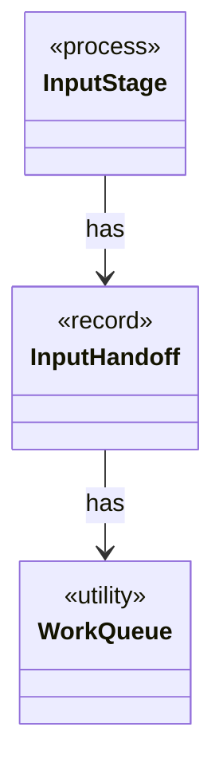

# `InputHandoff`

`io.github.tlaplus.hardening.workflow.input` · record · other · [source](https://github.com/tlaplus/model-checker-hardening/blob/5b16596dd480095d323ac67ff0f85eb85227b4b5/src/main/java/io/github/tlaplus/hardening/workflow/input/InputHandoff.java#L14) · module [workflow](../modules/workflow.md)

How the input stage hands entries to the parser: the parser's queue, and the `00-inputs` slots that bound how many entries wait in it.

The diagram draws 2 of 3 relations; the table lists them all.

| Direction | Relation | Type | Summary |
|---|---|---|---|
| → | has | [WorkQueue](io.github.tlaplus.hardening.workflow.execution.WorkQueue.md) | A close-aware multi-producer, multi-consumer queue; optionally ordered by priority. |
| ← | has | [InputStage](io.github.tlaplus.hardening.workflow.input.InputStage.md) | Concurrent input stage: admits reserved target ranges from adjacent generations. |
| ← | depends | [StageGraph](io.github.tlaplus.hardening.workflow.StageGraph.md) | The stages that run one workflow invocation, wired to their queues, result capacities, and shared collaborators, and the order in which they start and stop. |
