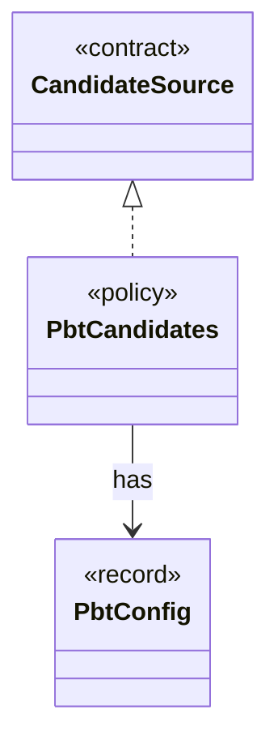

# `PbtCandidates`

`io.github.tlaplus.hardening.workflow.input` · class · policy · key · [source](https://github.com/tlaplus/model-checker-hardening/blob/4206d99417cbe58b5b339e189936abe305c56cca/src/main/java/io/github/tlaplus/hardening/workflow/input/PbtCandidates.java#L14) · module [workflow](../modules/workflow.md)

Property-based candidates (ADR 0002): a target draws one richness cohort, and every candidate for it is a uniformly random byte array of a length from `InputLengthSampler`.

**Decisions:** [ADR 0002: PBT collection-richness score](https://github.com/tlaplus/model-checker-hardening/blob/4206d99417cbe58b5b339e189936abe305c56cca/docs/decisions/0002-pbt-richness-score.md)

The diagram draws 2 of 4 relations; the table lists them all.

| Direction | Relation | Type | Summary |
|---|---|---|---|
| → | implements | [CandidateSource](io.github.tlaplus.hardening.workflow.input.CandidateSource.md) | Where the candidates for a target entry of the input stage come from: property-based generation or mutation of a selected parent (ADR 0010). |
| → | has | [PbtConfig](io.github.tlaplus.hardening.config.PbtConfig.md) | Limits and collection-richness controls for property-based input generation. |
| → | depends | [InputLengthSampler](io.github.tlaplus.hardening.workflow.input.InputLengthSampler.md) | Samples bounded lengths from uniformly selected logarithmic size buckets. |
| ← | depends | [GenerationLoop](io.github.tlaplus.hardening.workflow.GenerationLoop.md) | Runs the generations of one workflow invocation over a single stage graph (ADR 0010). |
