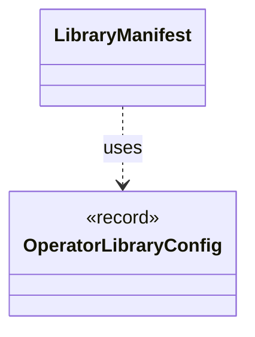

# `LibraryManifest`

`io.github.tlaplus.hardening.workflow.library` · class · other · [source](https://github.com/tlaplus/model-checker-hardening/blob/21262d9d0cc07b5ae4c47c4ee511217c9b88b561/src/main/java/io/github/tlaplus/hardening/workflow/library/LibraryManifest.java#L15) · module [workflow](../modules/workflow.md)

The identity of a custom operator library's source snapshot, which a metamorphic run compares with its base corpus's (ADR 0016 §6, ADR 0025 §5).

**Decisions:** [ADR 0016: Metamorphic testing](https://github.com/tlaplus/model-checker-hardening/blob/21262d9d0cc07b5ae4c47c4ee511217c9b88b561/docs/decisions/0016-metamorphic-testing.md), [ADR 0025: Self-contained corpora, chosen at `init`](https://github.com/tlaplus/model-checker-hardening/blob/21262d9d0cc07b5ae4c47c4ee511217c9b88b561/docs/decisions/0025-self-contained-corpora.md)

The diagram draws 1 of 7 relations; the table lists them all.

| Direction | Relation | Type | Summary |
|---|---|---|---|
| → | uses | [OperatorLibraryConfig](io.github.tlaplus.hardening.config.OperatorLibraryConfig.md) | Source-only library settings. |
| → | depends | [Digests](io.github.tlaplus.hardening.common.Digests.md) | SHA-256 identities for corpus payloads and external replay dependencies. |
| → | depends | [LibraryLinkage](io.github.tlaplus.hardening.gen.library.LibraryLinkage.md) | How a custom module's definitions reach the TLA+ source of the parser and TLC. |
| → | depends | [ModuleLink](io.github.tlaplus.hardening.gen.library.ModuleLink.md) | How one custom module is linked, and the module that its TLA+ source aliases instantiate: the module itself unless the linkage names a separate TLC module. |
| → | depends | [OperatorId](io.github.tlaplus.hardening.gen.library.OperatorId.md) | Case-sensitive identity of an exported operator, independent of its generated name. |
| ← | depends | [LibraryPreparation](io.github.tlaplus.hardening.workflow.library.LibraryPreparation.md) | Prepares custom libraries once before decoding; no importer/typechecker Maven dependency. |
| ← | depends | [RuleLibraryPreparation](io.github.tlaplus.hardening.workflow.library.RuleLibraryPreparation.md) | Loads a rule module once, before decoding (ADR 0017 §1, §6): the rewrites of a metamorphic run or the edge guards of graph inputs (ADR 0023 §6). |
