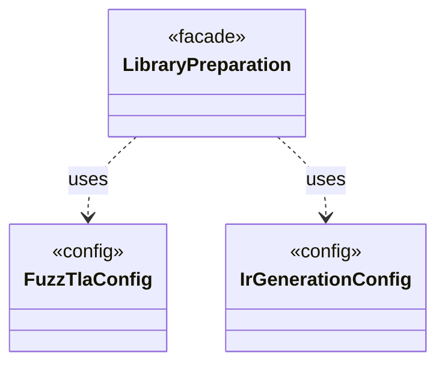

# `LibraryPreparation`

`io.github.tlaplus.hardening.workflow.library` · class · facade · key · [source](https://github.com/tlaplus/model-checker-hardening/blob/918f7db91890f302587d25c76dc7ac189db3d023/src/main/java/io/github/tlaplus/hardening/workflow/library/LibraryPreparation.java#L23) · module [workflow](../modules/workflow.md)

Prepares custom libraries once before decoding; no importer/typechecker Maven dependency.

The diagram draws 2 of 18 relations; the table lists them all.

| Direction | Relation | Type | Summary |
|---|---|---|---|
| → | uses | [FuzzTlaConfig](io.github.tlaplus.hardening.config.FuzzTlaConfig.md) | Complete configuration of input generation and workflow execution. |
| → | uses | [IrGenerationConfig](io.github.tlaplus.hardening.gen.IrGenerationConfig.md) | Settings for generated TLA+ expressions and modules. |
| → | depends | [TemporaryDirectory](io.github.tlaplus.hardening.common.TemporaryDirectory.md) | Owned temporary storage, removed on normal and exceptional completion. |
| → | depends | [CheckerStageConfig](io.github.tlaplus.hardening.config.CheckerStageConfig.md) | Capacity and resource limits for one model-checker stage. |
| → | depends | [OperatorLibraryConfig](io.github.tlaplus.hardening.config.OperatorLibraryConfig.md) | Source-only library settings. |
| → | depends | [ParserStageConfig](io.github.tlaplus.hardening.config.ParserStageConfig.md) | Capacity and timeout limits for the parser stage. |
| → | depends | [WorkflowConfig](io.github.tlaplus.hardening.config.WorkflowConfig.md) | Global and per-stage limits for the implemented fuzzing workflow. |
| → | depends | [CorpusStage](io.github.tlaplus.hardening.corpus.CorpusStage.md) | One implemented stage of the fuzzing pipeline, and the corpus directories it owns. |
| → | depends | [LibraryLinkage](io.github.tlaplus.hardening.gen.library.LibraryLinkage.md) | How a custom module's definitions reach the TLA+ source of the parser and TLC. |
| → | depends | [ModuleLink](io.github.tlaplus.hardening.gen.library.ModuleLink.md) | How one custom module is linked, and the module that its TLA+ source aliases instantiate: the module itself unless the linkage names a separate TLC module. |
| → | depends | [OperatorLibrary](io.github.tlaplus.hardening.gen.library.OperatorLibrary.md) | Immutable prepared library. |
| → | depends | [WorkflowException](io.github.tlaplus.hardening.workflow.WorkflowException.md) | Reports an infrastructure or lifecycle failure in a fuzzing workflow. |
| → | depends | [ApalacheDistribution](io.github.tlaplus.hardening.workflow.apalache.ApalacheDistribution.md) | Locates the pinned Apalache release JAR staged beside FuzzTLA's build output. |
| → | depends | [LibraryManifest](io.github.tlaplus.hardening.workflow.library.LibraryManifest.md) | Replay policy for external source snapshots. |
| → | depends | [LibrarySourceProbe](io.github.tlaplus.hardening.workflow.library.LibrarySourceProbe.md) | Parses every source alias of a prepared library once, with the classpath the parser and TLC workers receive (ADR 0015). |
| → | depends | [LibrarySources](io.github.tlaplus.hardening.workflow.library.LibrarySources.md) | Materializes an ordered module search path as one source-only snapshot for SANY. |
| → | depends | [LibraryTypechecker](io.github.tlaplus.hardening.workflow.library.LibraryTypechecker.md) | Finite, isolated Snowcat invocation producing a typed module rather than a checker verdict. |
| ← | depends | [SpecDecoders](io.github.tlaplus.hardening.workflow.spec.SpecDecoders.md) | Immutable registry of the decoders that turn stored payloads into checkable modules. |
