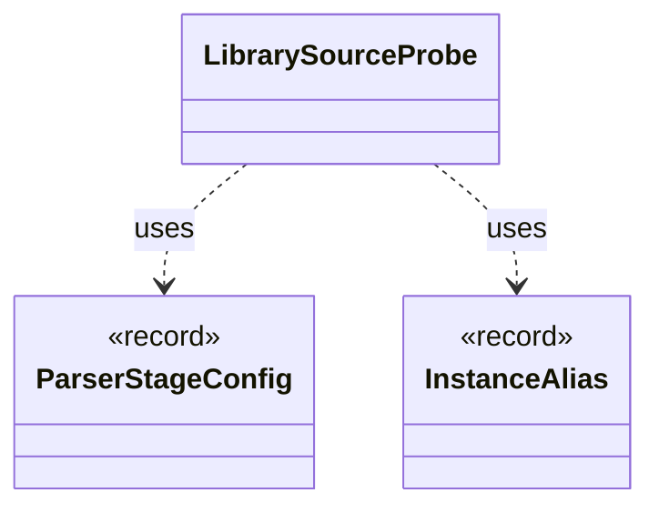

# `LibrarySourceProbe`

`io.github.tlaplus.hardening.workflow.library` · class · other · [source](https://github.com/tlaplus/model-checker-hardening/blob/fd29bdb142d5d87538f91aeddca09d5ac3d7d0a7/src/main/java/io/github/tlaplus/hardening/workflow/library/LibrarySourceProbe.java#L21) · module [workflow](../modules/workflow.md)

Parses every source alias of a prepared library once, with the classpath the parser and TLC workers receive (ADR 0015).

**Decisions:** [ADR 0015: Diff-linked libraries for recursion testing](https://github.com/tlaplus/model-checker-hardening/blob/fd29bdb142d5d87538f91aeddca09d5ac3d7d0a7/docs/decisions/0015-diff-linked-libraries.md)

The diagram draws 2 of 10 relations; the table lists them all.

| Direction | Relation | Type | Summary |
|---|---|---|---|
| → | uses | [ParserStageConfig](io.github.tlaplus.hardening.config.ParserStageConfig.md) | Capacity and timeout limits for the parser stage. |
| → | uses | [InstanceAlias](io.github.tlaplus.hardening.gen.library.InstanceAlias.md) | A library name the TLA+ source defines as `name(p1, ..., pn) == I!Operator(p1, ..., pn)`, where `I` is the named instance of `sourceModule`: the target's module, or the separate TLC module of a diff-linked one. |
| → | depends | [WorkflowException](io.github.tlaplus.hardening.workflow.WorkflowException.md) | Reports an infrastructure or lifecycle failure in a fuzzing workflow. |
| → | depends | [ParserBackend](io.github.tlaplus.hardening.workflow.parser.ParserBackend.md) | Runs SANY in persistent isolated JVMs, one per stage worker, each replaced after a crash. |
| → | depends | [SpecText](io.github.tlaplus.hardening.workflow.spec.SpecText.md) | Renders an assembled module as the TLA+ source that the parser and TLC consume. |
| → | depends | [ToolWorker](io.github.tlaplus.hardening.workflow.tool.ToolWorker.md) | Worker-local tool state used for one or more sequential inputs. |
| → | depends | [StageOutcome](io.github.tlaplus.hardening.workflow.worker.StageOutcome.md) | Common result of processing one input in a checking stage. |
| → | depends | [ToolInput](io.github.tlaplus.hardening.workflow.worker.ToolInput.md) | One rendered specification and what the receiving checker is asked about it. |
| → | depends | [ToolResult](io.github.tlaplus.hardening.workflow.worker.ToolResult.md) | One request result returned by an isolated tool worker. |
| ← | depends | [LibraryPreparation](io.github.tlaplus.hardening.workflow.library.LibraryPreparation.md) | Prepares custom libraries once before decoding; no importer/typechecker Maven dependency. |
