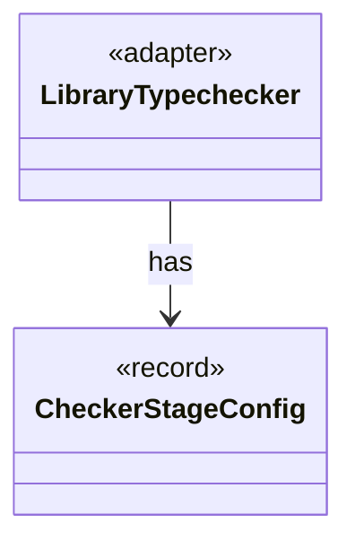

# `LibraryTypechecker`

`io.github.tlaplus.hardening.workflow.library` · class · adapter · key · [source](https://github.com/tlaplus/model-checker-hardening/blob/6bd7d927f1cffd7642029a3d925dff47091ddde9/src/main/java/io/github/tlaplus/hardening/workflow/library/LibraryTypechecker.java#L20) · module [workflow](../modules/workflow.md)

Finite, isolated Snowcat invocation producing a typed module rather than a checker verdict.

The diagram draws 1 of 8 relations; the table lists them all.

| Direction | Relation | Type | Summary |
|---|---|---|---|
| → | has | [CheckerStageConfig](io.github.tlaplus.hardening.config.CheckerStageConfig.md) | Capacity and resource limits for one model-checker stage. |
| → | depends | [WorkflowException](io.github.tlaplus.hardening.workflow.WorkflowException.md) | Reports an infrastructure or lifecycle failure in a fuzzing workflow. |
| → | depends | [ApalacheIrJson](io.github.tlaplus.hardening.workflow.apalache.ApalacheIrJson.md) | Renders an assembled module as the typed Apalache IR JSON that Apalache consumes. |
| → | depends | [LibraryJson](io.github.tlaplus.hardening.workflow.library.LibraryJson.md) | Prunes typechecker JSON to the operator declarations reachable from the selected operators. |
| → | depends | [JavaLaunch](io.github.tlaplus.hardening.workflow.worker.JavaLaunch.md) | How this project spells a child JVM launch, so every caller spells it the same way. |
| → | depends | [OneShotTool](io.github.tlaplus.hardening.workflow.worker.OneShotTool.md) | A finite CLI invocation, unlike protocol workers which serve a sequence of per-input requests. |
| ← | depends | [LibraryPreparation](io.github.tlaplus.hardening.workflow.library.LibraryPreparation.md) | Prepares custom libraries once before decoding; no importer/typechecker Maven dependency. |
| ← | depends | [RuleLibraryPreparation](io.github.tlaplus.hardening.workflow.library.RuleLibraryPreparation.md) | Loads the rule module of a metamorphic run once, before decoding (ADR 0017 §1, §6): SANY names its rules and reads their weight annotations, Snowcat types them, and `RewriteLibrary` checks the rule contract. |
