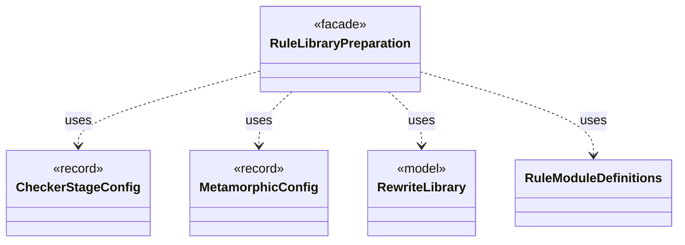

# `RuleLibraryPreparation`

`io.github.tlaplus.hardening.workflow.library` · class · facade · key · [source](https://github.com/tlaplus/model-checker-hardening/blob/4206d99417cbe58b5b339e189936abe305c56cca/src/main/java/io/github/tlaplus/hardening/workflow/library/RuleLibraryPreparation.java#L27) · module [workflow](../modules/workflow.md)

Loads the rule module of a metamorphic run once, before decoding (ADR 0017 §1, §6): SANY names its rules and reads their weight annotations, Snowcat types them, and `RewriteLibrary` checks the rule contract.

**Decisions:** [ADR 0017: Rewrite rules as a TLA+ library](https://github.com/tlaplus/model-checker-hardening/blob/4206d99417cbe58b5b339e189936abe305c56cca/docs/decisions/0017-rewrite-rule-library.md)

The diagram draws 4 of 11 relations; the table lists them all.

| Direction | Relation | Type | Summary |
|---|---|---|---|
| → | uses | [CheckerStageConfig](io.github.tlaplus.hardening.config.CheckerStageConfig.md) | Capacity and resource limits for one model-checker stage. |
| → | uses | [MetamorphicConfig](io.github.tlaplus.hardening.config.MetamorphicConfig.md) | The `[metamorphic]` table (ADR 0016 §7, ADR 0017 §1): what a `--how=mt` run reads besides the generator settings. |
| → | uses | [RewriteLibrary](io.github.tlaplus.hardening.gen.rewrite.RewriteLibrary.md) | The rules of one rule module, in declaration order (ADR 0017 §1). |
| → | uses | [RuleModuleDefinitions](io.github.tlaplus.hardening.workflow.library.RuleModuleDefinitions.md) | Names the top-level definitions of a rule module itself, in declaration order, with the weight each one's comments annotate (ADR 0017 §1). |
| → | depends | [TemporaryDirectory](io.github.tlaplus.hardening.common.TemporaryDirectory.md) | Owned temporary storage, removed on normal and exceptional completion. |
| → | depends | [WorkflowException](io.github.tlaplus.hardening.workflow.WorkflowException.md) | Reports an infrastructure or lifecycle failure in a fuzzing workflow. |
| → | depends | [ApalacheDistribution](io.github.tlaplus.hardening.workflow.apalache.ApalacheDistribution.md) | Locates the pinned Apalache release JAR staged beside FuzzTLA's build output. |
| → | depends | [LibraryManifest](io.github.tlaplus.hardening.workflow.library.LibraryManifest.md) | Replay policy for external source snapshots. |
| → | depends | [LibrarySources](io.github.tlaplus.hardening.workflow.library.LibrarySources.md) | Materializes an ordered module search path as one source-only snapshot for SANY. |
| → | depends | [LibraryTypechecker](io.github.tlaplus.hardening.workflow.library.LibraryTypechecker.md) | Finite, isolated Snowcat invocation producing a typed module rather than a checker verdict. |
| ← | depends | [SpecDecoders](io.github.tlaplus.hardening.workflow.spec.SpecDecoders.md) | Immutable registry of the decoders that turn stored payloads into checkable modules. |
