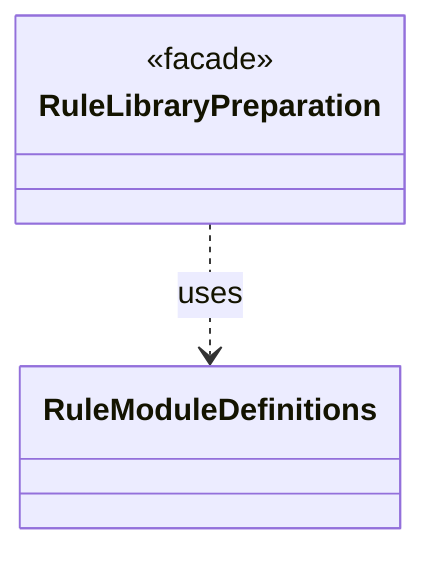

# `RuleModuleDefinitions`

`io.github.tlaplus.hardening.workflow.library` · class · other · [source](https://github.com/tlaplus/model-checker-hardening/blob/3df8c8564b58e946b95079b671788c8315f98831/src/main/java/io/github/tlaplus/hardening/workflow/library/RuleModuleDefinitions.java#L30) · module [workflow](../modules/workflow.md)

Names the top-level definitions of a rule module itself, in declaration order, with the weight each one's comments annotate (ADR 0017 §1).

**Decisions:** [ADR 0017: Rewrite rules as a TLA+ library](https://github.com/tlaplus/model-checker-hardening/blob/3df8c8564b58e946b95079b671788c8315f98831/docs/decisions/0017-rewrite-rule-library.md)

The diagram draws 1 of 2 relations; the table lists them all.

| Direction | Relation | Type | Summary |
|---|---|---|---|
| ← | uses | [RuleLibraryPreparation](io.github.tlaplus.hardening.workflow.library.RuleLibraryPreparation.md) | Loads the rule module of a metamorphic run once, before decoding (ADR 0017 §1, §6): SANY names its rules and reads their weight annotations, Snowcat types them, and `RewriteLibrary` checks the rule contract. |
| → | depends | [WorkflowException](io.github.tlaplus.hardening.workflow.WorkflowException.md) | Reports an infrastructure or lifecycle failure in a fuzzing workflow. |
