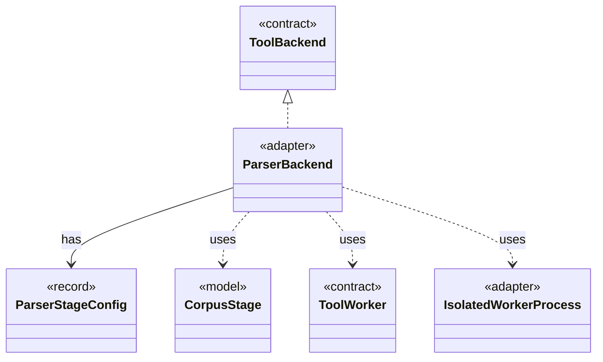

# `ParserBackend`

`io.github.tlaplus.hardening.workflow.parser` · class · adapter · key · [source](https://github.com/tlaplus/model-checker-hardening/blob/6bbf8b66c375696d1798f7b7a061b81573a3f42a/src/main/java/io/github/tlaplus/hardening/workflow/parser/ParserBackend.java#L22) · module [workflow](../modules/workflow.md)

Runs SANY in persistent isolated JVMs, one per stage worker, each replaced after a crash.

The diagram draws 5 of 13 relations; the table lists them all.

| Direction | Relation | Type | Summary |
|---|---|---|---|
| → | implements | [ToolBackend](io.github.tlaplus.hardening.workflow.tool.ToolBackend.md) | Tool-specific behavior injected into the shared `ToolStage`. |
| → | has | [ParserStageConfig](io.github.tlaplus.hardening.config.ParserStageConfig.md) | Capacity and timeout limits for the parser stage. |
| → | uses | [CorpusStage](io.github.tlaplus.hardening.corpus.CorpusStage.md) | One implemented stage of the fuzzing pipeline, and the corpus directories it owns. |
| → | uses | [ToolWorker](io.github.tlaplus.hardening.workflow.tool.ToolWorker.md) | Worker-local tool state used for one or more sequential inputs. |
| → | uses | [IsolatedWorkerProcess](io.github.tlaplus.hardening.workflow.worker.IsolatedWorkerProcess.md) | Parent-side supervisor for one isolated Java tool worker. |
| → | depends | [Preconditions](io.github.tlaplus.hardening.common.Preconditions.md) | Shared validation of method and constructor arguments. |
| → | depends | [WorkflowException](io.github.tlaplus.hardening.workflow.WorkflowException.md) | Reports an infrastructure or lifecycle failure in a fuzzing workflow. |
| → | depends | [ParserWorkerMain](io.github.tlaplus.hardening.workflow.parser.ParserWorkerMain.md) | Child-process entry point for persistent isolated SANY requests. |
| → | depends | [ProcessToolWorker](io.github.tlaplus.hardening.workflow.tool.ProcessToolWorker.md) | A tool worker served by one isolated child process until a crash verdict retires it. |
| → | depends | [ChildJvm](io.github.tlaplus.hardening.workflow.worker.ChildJvm.md) | The resources and options of one child JVM. |
| → | depends | [WorkerSpec](io.github.tlaplus.hardening.workflow.worker.WorkerSpec.md) | How to launch one isolated tool worker: where it may write, how long it may take to come up, which class it runs, what goes in front of this JVM's class path, the child JVM it runs in, and what to call it in diagnostics. |
| ← | depends | [StageGraph](io.github.tlaplus.hardening.workflow.StageGraph.md) | The stages that run one workflow invocation, wired to their queues, result capacities, and shared collaborators, and the order in which they start and stop. |
| ← | depends | [LibrarySourceProbe](io.github.tlaplus.hardening.workflow.library.LibrarySourceProbe.md) | Parses every source alias of a prepared library once, with the classpath the parser and TLC workers receive (ADR 0015). |
