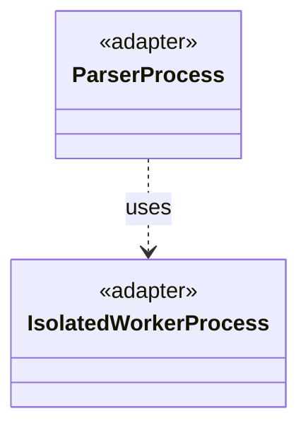

# `ParserProcess`

`io.github.tlaplus.hardening.workflow.parser` · class · adapter · key · [source](https://github.com/tlaplus/model-checker-hardening/blob/3df8c8564b58e946b95079b671788c8315f98831/src/main/java/io/github/tlaplus/hardening/workflow/parser/ParserProcess.java#L15) · module [workflow](../modules/workflow.md)

Starts one persistent isolated SANY JVM; the common process handle owns requests and closing.

The diagram draws 1 of 6 relations; the table lists them all.

| Direction | Relation | Type | Summary |
|---|---|---|---|
| → | uses | [IsolatedWorkerProcess](io.github.tlaplus.hardening.workflow.worker.IsolatedWorkerProcess.md) | Parent-side supervisor for one isolated Java tool worker. |
| → | depends | [WorkflowException](io.github.tlaplus.hardening.workflow.WorkflowException.md) | Reports an infrastructure or lifecycle failure in a fuzzing workflow. |
| → | depends | [ParserWorkerMain](io.github.tlaplus.hardening.workflow.parser.ParserWorkerMain.md) | Child-process entry point for persistent isolated SANY requests. |
| → | depends | [ChildJvm](io.github.tlaplus.hardening.workflow.worker.ChildJvm.md) | The resources and options of one child JVM. |
| → | depends | [WorkerSpec](io.github.tlaplus.hardening.workflow.worker.WorkerSpec.md) | How to launch one isolated tool worker: where it may write, how long it may take to come up, which class it runs, what goes in front of this JVM's class path, the child JVM it runs in, and what to call it in diagnostics. |
| ← | depends | [ParserBackend](io.github.tlaplus.hardening.workflow.parser.ParserBackend.md) | Runs SANY in persistent isolated JVMs, one per stage worker, each replaced after a crash. |
