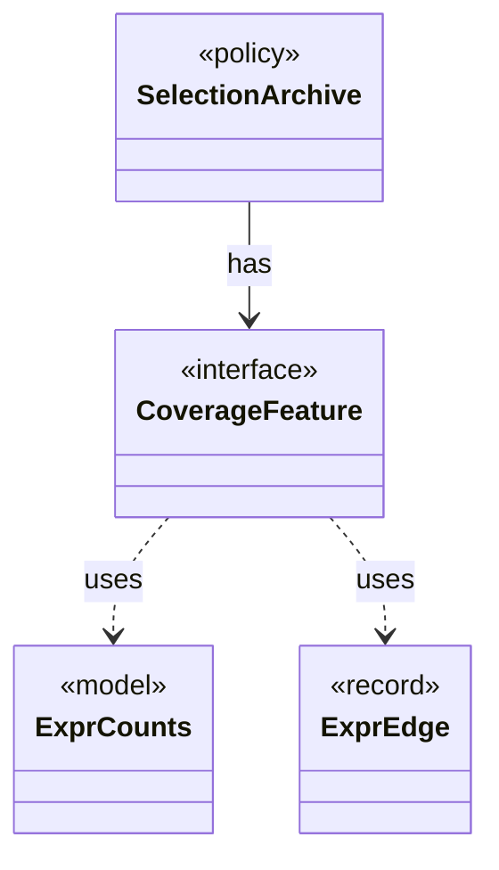

# `CoverageFeature`

`io.github.tlaplus.hardening.workflow.quality` · interface · other · [source](https://github.com/tlaplus/model-checker-hardening/blob/ed5c97e61582ad2ff90b4ea4209355aa0d555717/src/main/java/io/github/tlaplus/hardening/workflow/quality/CoverageFeature.java#L13) · module [workflow](../modules/workflow.md)

One operator-coverage feature of an entry's evaluated code (ADR 0013): a construct or an edge between constructs, with the hit-count bucket of its occurrences.

**Decisions:** [ADR 0013: Behaviour archive and operator-edge coverage](https://github.com/tlaplus/model-checker-hardening/blob/ed5c97e61582ad2ff90b4ea4209355aa0d555717/docs/decisions/0013-behaviour-archive-and-operator-coverage.md)

The diagram draws 3 of 4 relations; the table lists them all.

| Direction | Relation | Type | Summary |
|---|---|---|---|
| ← | has | [SelectionArchive](io.github.tlaplus.hardening.workflow.quality.SelectionArchive.md) | The behaviour cells and coverage features of the entries the gate has kept (ADR 0013), and the rule that decides whether one more entry is kept. |
| → | uses | [ExprCounts](io.github.tlaplus.hardening.common.ExprCounts.md) | The size of a piece of TLA+ code, the occurrences of each expression construct in it, and the occurrences of each edge between constructs. |
| → | uses | [ExprEdge](io.github.tlaplus.hardening.common.ExprEdge.md) | An edge of an expression tree between two constructs: `parent` applied to, or binding, an immediate subexpression that is the construct `child`. |
| ← | depends | [QualityGate](io.github.tlaplus.hardening.workflow.quality.QualityGate.md) | Selects the parents of the next generation from one settled generation (ADR 0010, ADR 0013). |
