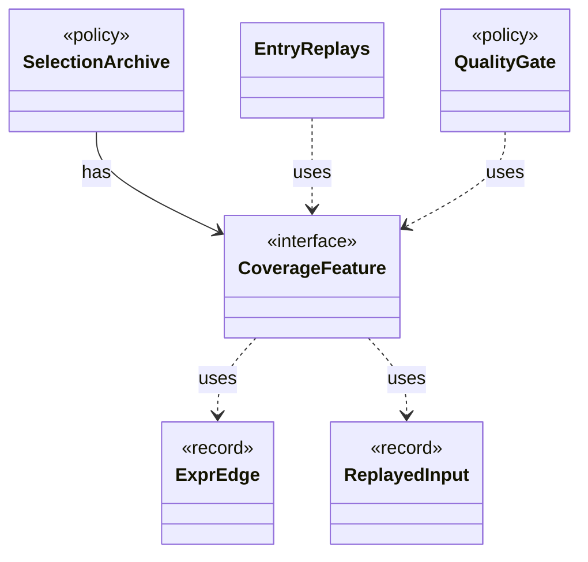

# `CoverageFeature`

`io.github.tlaplus.hardening.workflow.quality` · interface · other · [source](https://github.com/tlaplus/model-checker-hardening/blob/efb80f561357d9a62d3b24e493bb2f450ab6410c/src/main/java/io/github/tlaplus/hardening/workflow/quality/CoverageFeature.java#L14) · module [workflow](../modules/workflow.md)

One coverage feature of an entry, with the hit-count bucket of its occurrences: a construct or an edge between constructs of its evaluated code (ADR 0013), or a temporal shape of its property (ADR 0028 §3).

**Decisions:** [ADR 0013: Behaviour archive and operator-edge coverage](https://github.com/tlaplus/model-checker-hardening/blob/efb80f561357d9a62d3b24e493bb2f450ab6410c/docs/decisions/0013-behaviour-archive-and-operator-coverage.md), [ADR 0028: Temporal properties that read the state](https://github.com/tlaplus/model-checker-hardening/blob/efb80f561357d9a62d3b24e493bb2f450ab6410c/docs/decisions/0028-temporal-property-quality.md)

The diagram draws 5 of 6 relations; the table lists them all.

| Direction | Relation | Type | Summary |
|---|---|---|---|
| ← | has | [SelectionArchive](io.github.tlaplus.hardening.workflow.quality.SelectionArchive.md) | The behaviour cells and coverage features of the entries the gate has kept (ADR 0013), and the rule that decides whether one more entry is kept. |
| → | uses | [ExprEdge](io.github.tlaplus.hardening.common.ExprEdge.md) | An edge of an expression tree between two constructs: `parent` applied to, or binding, an immediate subexpression that is the construct `child`. |
| → | uses | [ReplayedInput](io.github.tlaplus.hardening.corpus.ReplayedInput.md) | What replaying one stored input shows beyond its envelope. |
| ← | uses | [EntryReplays](io.github.tlaplus.hardening.workflow.quality.EntryReplays.md) | What one run of the quality gate learns by replaying its entries: their coverage features (ADR 0013) and the number of distinct temporal shapes of their properties (ADR 0028). |
| ← | uses | [QualityGate](io.github.tlaplus.hardening.workflow.quality.QualityGate.md) | Selects the parents of the next generation from one settled generation (ADR 0010, ADR 0013). |
| → | depends | [ExprCounts](io.github.tlaplus.hardening.common.ExprCounts.md) | The size of a piece of TLA+ code, the occurrences of each expression construct in it, and the occurrences of each edge between constructs. |
