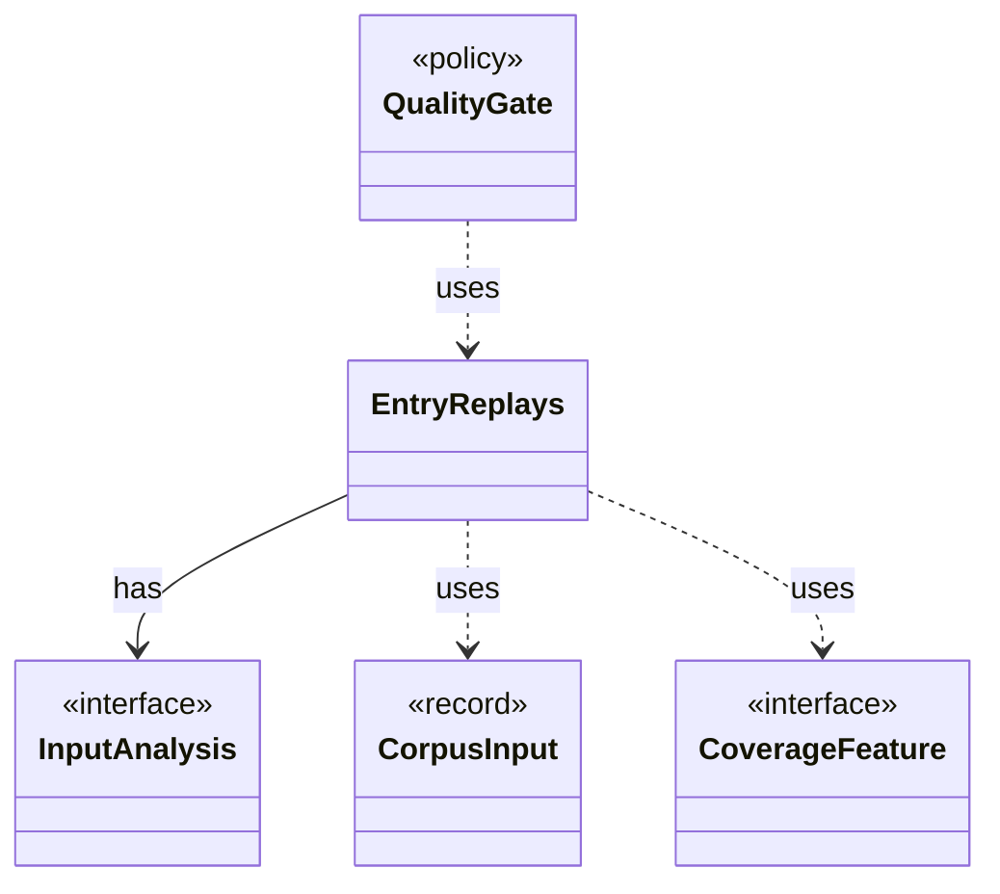

# `EntryReplays`

`io.github.tlaplus.hardening.workflow.quality` · class · other · [source](https://github.com/tlaplus/model-checker-hardening/blob/d5dcbcb332600c9312f00550a0131fd51a164e9f/src/main/java/io/github/tlaplus/hardening/workflow/quality/EntryReplays.java#L16) · module [workflow](../modules/workflow.md)

What one run of the quality gate learns by replaying its entries: their coverage features (ADR 0013) and the number of distinct temporal shapes of their properties (ADR 0028).

**Decisions:** [ADR 0013: Behaviour archive and operator-edge coverage](https://github.com/tlaplus/model-checker-hardening/blob/d5dcbcb332600c9312f00550a0131fd51a164e9f/docs/decisions/0013-behaviour-archive-and-operator-coverage.md), [ADR 0028: Temporal properties that read the state](https://github.com/tlaplus/model-checker-hardening/blob/d5dcbcb332600c9312f00550a0131fd51a164e9f/docs/decisions/0028-temporal-property-quality.md)

The diagram draws 4 of 5 relations; the table lists them all.

| Direction | Relation | Type | Summary |
|---|---|---|---|
| → | has | [InputAnalysis](io.github.tlaplus.hardening.corpus.InputAnalysis.md) | Counts the evaluated nodes, expression constructs and construct edges of one stored input, and names the rewrite rules it applied, typically by replaying it through the generator. |
| → | uses | [CorpusInput](io.github.tlaplus.hardening.corpus.CorpusInput.md) | The required fields of one encoded corpus input. |
| → | uses | [CoverageFeature](io.github.tlaplus.hardening.workflow.quality.CoverageFeature.md) | One coverage feature of an entry, with the hit-count bucket of its occurrences: a construct or an edge between constructs of its evaluated code (ADR 0013), or a temporal shape of its property (ADR 0028 §3). |
| ← | uses | [QualityGate](io.github.tlaplus.hardening.workflow.quality.QualityGate.md) | Selects the parents of the next generation from one settled generation (ADR 0010, ADR 0013). |
| → | depends | [ReplayedInput](io.github.tlaplus.hardening.corpus.ReplayedInput.md) | What replaying one stored input shows beyond its envelope. |
