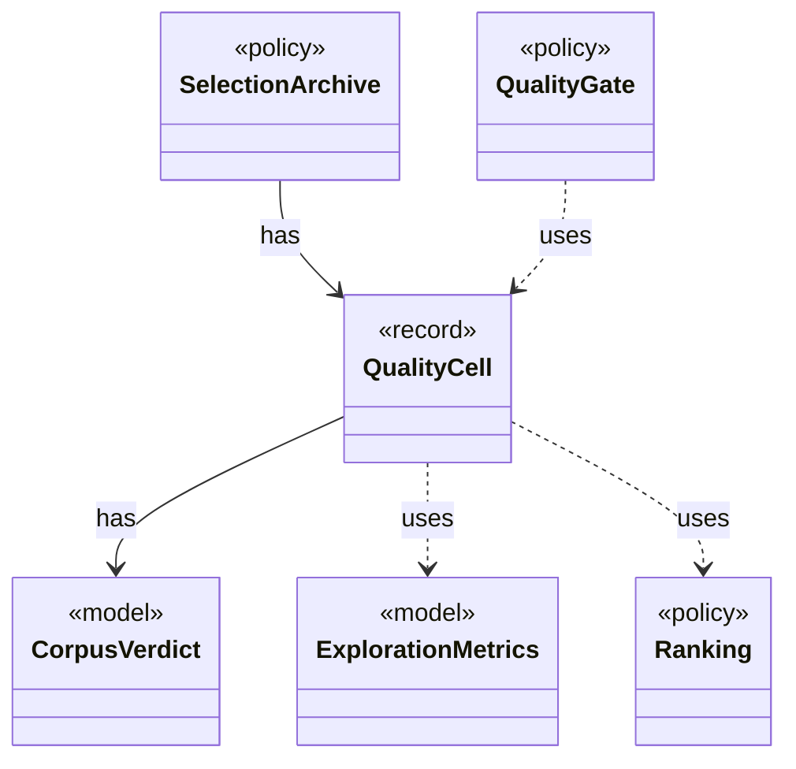

# `QualityCell`

`io.github.tlaplus.hardening.workflow.quality` · record · other · [source](https://github.com/tlaplus/model-checker-hardening/blob/b96eff75a5bbf8a60b15ad020d6e84735c75a47c/src/main/java/io/github/tlaplus/hardening/workflow/quality/QualityCell.java#L13) · module [workflow](../modules/workflow.md)

The behaviour cell of an admissible entry (ADR 0013): its TLC verdict and the components of the gate's `Ranking`, each after its bucket.

**Decisions:** [ADR 0013: Behaviour archive and operator-edge coverage](https://github.com/tlaplus/model-checker-hardening/blob/b96eff75a5bbf8a60b15ad020d6e84735c75a47c/docs/decisions/0013-behaviour-archive-and-operator-coverage.md)

| Direction | Relation | Type | Summary |
|---|---|---|---|
| → | has | [CorpusVerdict](io.github.tlaplus.hardening.corpus.CorpusVerdict.md) | A verdict supported by the implemented corpus stages. |
| ← | has | [SelectionArchive](io.github.tlaplus.hardening.workflow.quality.SelectionArchive.md) | The behaviour cells and coverage features of the entries the gate has kept (ADR 0013), and the rule that decides whether one more entry is kept. |
| → | uses | [ExplorationMetrics](io.github.tlaplus.hardening.checker.ExplorationMetrics.md) | What a model checker explored to reach its verdict, as ADR 0008 defines it. |
| → | uses | [Ranking](io.github.tlaplus.hardening.corpus.Ranking.md) | How the quality gate ranks the admissible entries of a generation, best first: the components of its key, compared lexicographically, higher first. |
| ← | uses | [QualityGate](io.github.tlaplus.hardening.workflow.quality.QualityGate.md) | Selects the parents of the next generation from one settled generation (ADR 0010, ADR 0013). |
