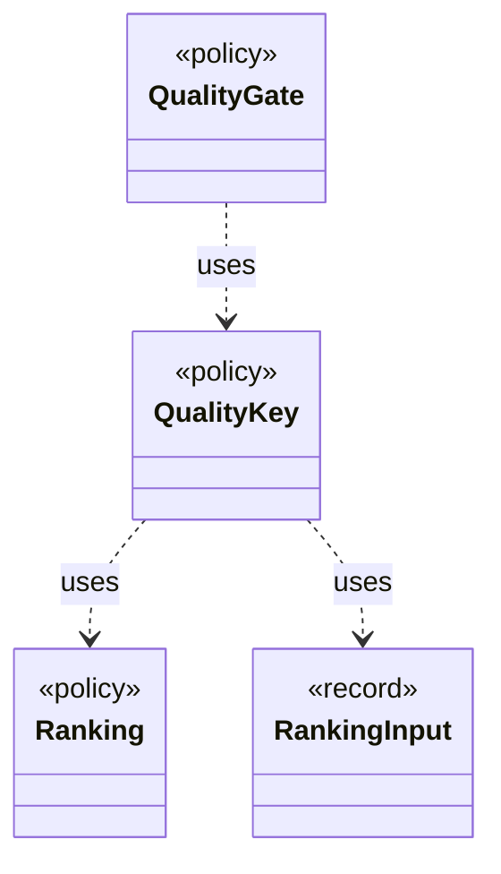

# `QualityKey`

`io.github.tlaplus.hardening.workflow.quality` · class · policy · key · [source](https://github.com/tlaplus/model-checker-hardening/blob/364baf41a0dd399c6d0563acc88702569b58407d/src/main/java/io/github/tlaplus/hardening/workflow/quality/QualityKey.java#L19) · module [workflow](../modules/workflow.md)

The order in which the quality gate ranks admissible entries, best first (ADR 0010, ADR 0024 §2).

**Decisions:** [ADR 0010: Generational mutation](https://github.com/tlaplus/model-checker-hardening/blob/364baf41a0dd399c6d0563acc88702569b58407d/docs/decisions/0010-mutation.md), [ADR 0024: Action coverage in the selection of graph entries](https://github.com/tlaplus/model-checker-hardening/blob/364baf41a0dd399c6d0563acc88702569b58407d/docs/decisions/0024-graph-action-coverage.md)

| Direction | Relation | Type | Summary |
|---|---|---|---|
| → | uses | [Ranking](io.github.tlaplus.hardening.corpus.Ranking.md) | How the quality gate ranks the admissible entries of a generation, best first: the components of its key, compared lexicographically, higher first. |
| → | uses | [RankingInput](io.github.tlaplus.hardening.corpus.RankingInput.md) | What a `Ranking` reads of one entry: TLC's exploration metrics and the counts that replaying the input yields. |
| ← | uses | [QualityGate](io.github.tlaplus.hardening.workflow.quality.QualityGate.md) | Selects the parents of the next generation from one settled generation (ADR 0010, ADR 0013). |
