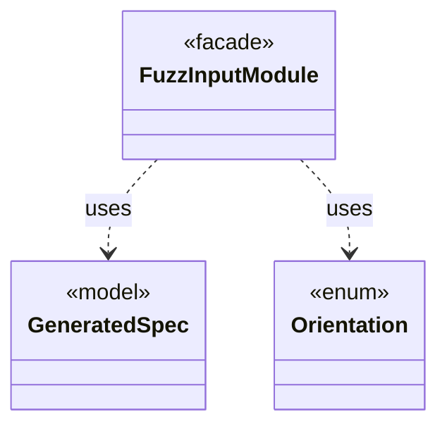

# `FuzzInputModule`

`io.github.tlaplus.hardening.workflow.spec` · class · facade · key · [source](https://github.com/tlaplus/model-checker-hardening/blob/a304ba37155136c3ba79e4f2fb414cbb47d01606/src/main/java/io/github/tlaplus/hardening/workflow/spec/FuzzInputModule.java#L37) · module [workflow](../modules/workflow.md)

Assembles the module checked by the parser and model-checker stages.

The diagram draws 2 of 12 relations; the table lists them all.

| Direction | Relation | Type | Summary |
|---|---|---|---|
| → | uses | [GeneratedSpec](io.github.tlaplus.hardening.gen.GeneratedSpec.md) | The declarations one generated module consists of. |
| → | uses | [Orientation](io.github.tlaplus.hardening.gen.rewrite.Orientation.md) | Which side of a metamorphic pair the checker explores (ADR 0016 §3). |
| → | depends | [GeneratedOperator](io.github.tlaplus.hardening.gen.GeneratedOperator.md) | A generated definition, stored once in module declaration order. |
| → | depends | [TemporalProperty](io.github.tlaplus.hardening.gen.TemporalProperty.md) | The temporal property of a generated module and the fairness that constrains it. |
| → | depends | [IrNames](io.github.tlaplus.hardening.gen.ir.IrNames.md) | Names in typed IR: injective renaming and the names an expression reads from its context. |
| ← | depends | [RewriteReport](io.github.tlaplus.hardening.cli.RewriteReport.md) | Renders a metamorphic pair for triage (ADR 0016 §8): which side the checkers explore, the rules applied in order, and both sides. |
| ← | depends | [ApalacheArguments](io.github.tlaplus.hardening.workflow.apalache.ApalacheArguments.md) | The Apalache command line for one checked module. |
| ← | depends | [ApalacheWorkerMain](io.github.tlaplus.hardening.workflow.apalache.ApalacheWorkerMain.md) | Persistent child process that invokes Apalache's `Tool.run` sequentially. |
| ← | depends | [ParserWorkerMain](io.github.tlaplus.hardening.workflow.parser.ParserWorkerMain.md) | Child-process entry point for persistent isolated SANY requests. |
| ← | depends | [SpecArtifact](io.github.tlaplus.hardening.workflow.spec.SpecArtifact.md) | One assembled module, what its checkers are asked about it, and what its decoder produced. |
| ← | depends | [TlcConfiguration](io.github.tlaplus.hardening.workflow.tlc.TlcConfiguration.md) | The TLC configuration file for one checked module. |
| ← | depends | [TlcWorkerMain](io.github.tlaplus.hardening.workflow.tlc.TlcWorkerMain.md) | One-shot TLC child process. |
