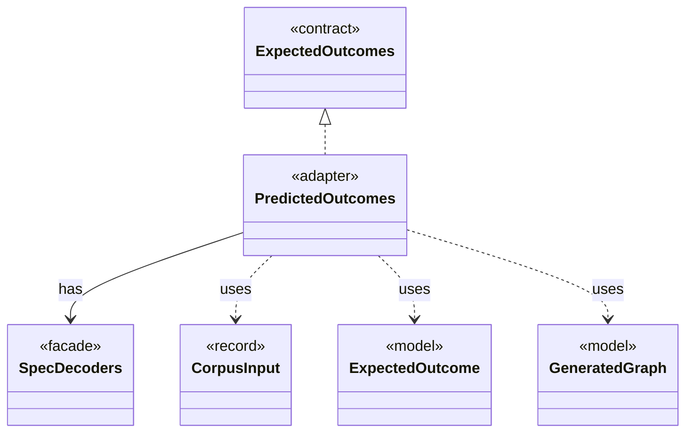

# `PredictedOutcomes`

`io.github.tlaplus.hardening.workflow.spec` · class · adapter · [source](https://github.com/tlaplus/model-checker-hardening/blob/dd877bc2dce59141917dd1003529d40721d7efc1/src/main/java/io/github/tlaplus/hardening/workflow/spec/PredictedOutcomes.java#L26) · module [workflow](../modules/workflow.md)

Predicts the outcome of an entry whose kind predicts one: a graph entry, by replaying it through the decoders (ADR 0023 §4): a counterexample of the target's distance when a behaviour reaches the target within the step bound, and a pass otherwise; a trace entry (ADR 0034 §4): a counterexample of exactly the trace's transitions, which its payload states without decoding the base.

**Decisions:** [ADR 0023: Graph-based testing](https://github.com/tlaplus/model-checker-hardening/blob/dd877bc2dce59141917dd1003529d40721d7efc1/docs/decisions/0023-graph-based-testing.md), [ADR 0034: Replaying counterexamples as corpus inputs](https://github.com/tlaplus/model-checker-hardening/blob/dd877bc2dce59141917dd1003529d40721d7efc1/docs/decisions/0034-counterexample-replay.md)

The diagram draws 5 of 11 relations; the table lists them all.

| Direction | Relation | Type | Summary |
|---|---|---|---|
| → | implements | [ExpectedOutcomes](io.github.tlaplus.hardening.corpus.ExpectedOutcomes.md) | Predicts the outcome of one stored input, typically by replaying it through the generator (ADR 0023 §5). |
| → | has | [SpecDecoders](io.github.tlaplus.hardening.workflow.spec.SpecDecoders.md) | Immutable registry of the decoders that turn stored payloads into checkable modules. |
| → | uses | [CorpusInput](io.github.tlaplus.hardening.corpus.CorpusInput.md) | The required fields of one encoded corpus input. |
| → | uses | [ExpectedOutcome](io.github.tlaplus.hardening.corpus.ExpectedOutcome.md) | The checker verdict an input predicts, independently of any checker (ADR 0023 §4): a graph input predicts a counterexample of known length when its target is reachable within the step bound, and a pass otherwise. |
| → | uses | [GeneratedGraph](io.github.tlaplus.hardening.gen.graph.GeneratedGraph.md) | A module decoded from a graph input (ADR 0023 §2), with the graph it encodes and the target its invariant `pc /= target` names. |
| → | depends | [InputKind](io.github.tlaplus.hardening.gen.InputKind.md) | What a generator payload decodes to. |
| → | depends | [Trace](io.github.tlaplus.hardening.gen.trace.Trace.md) | The states of one recorded counterexample and what its last state claims (ADR 0034 §1, §2). |
| → | depends | [TracePayload](io.github.tlaplus.hardening.gen.trace.TracePayload.md) | The payload of a `trace` input (ADR 0034 §2), a CBOR array in deterministic encoding: |
| → | depends | [SpecArtifact](io.github.tlaplus.hardening.workflow.spec.SpecArtifact.md) | One assembled module, what its checkers are asked about it, and what its decoder produced. |
| ← | depends | [DecodedInputRenderer](io.github.tlaplus.hardening.cli.DecodedInputRenderer.md) | Renders a decoded input independently of picocli command wiring. |
| ← | depends | [WorkflowRunner](io.github.tlaplus.hardening.workflow.WorkflowRunner.md) | Runs generation, parsing, TLC, Apalache, conformance aggregation and the quality gate under one CPU budget. |
