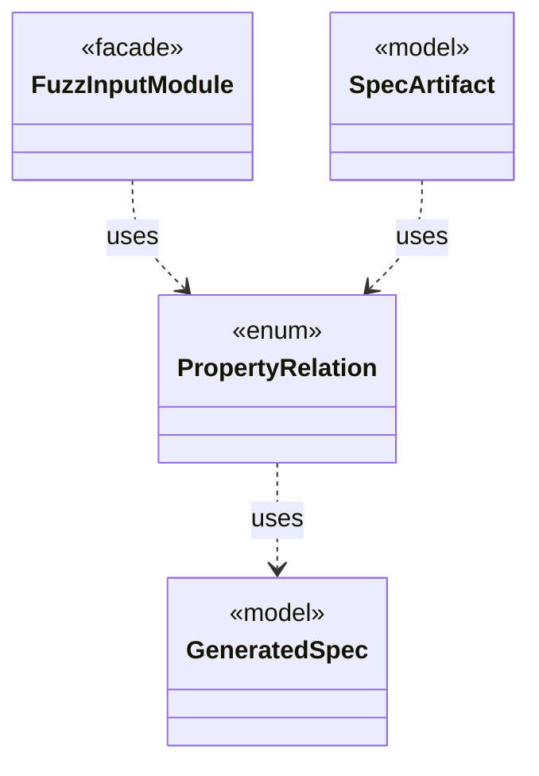

# `PropertyRelation`

`io.github.tlaplus.hardening.workflow.spec` · enum · other · [source](https://github.com/tlaplus/model-checker-hardening/blob/f155219d1aadc24f25dc2ccc477c57ea6b4e38a8/src/main/java/io/github/tlaplus/hardening/workflow/spec/PropertyRelation.java#L8) · module [workflow](../modules/workflow.md)

How the relation module of a metamorphic pair of modules treats their properties and fairness.

The diagram draws 3 of 5 relations; the table lists them all.

| Direction | Relation | Type | Summary |
|---|---|---|---|
| → | uses | [GeneratedSpec](io.github.tlaplus.hardening.gen.GeneratedSpec.md) | The declarations one generated module consists of. |
| ← | uses | [FuzzInputModule](io.github.tlaplus.hardening.workflow.spec.FuzzInputModule.md) | Assembles the module checked by the parser and model-checker stages. |
| ← | uses | [SpecArtifact](io.github.tlaplus.hardening.workflow.spec.SpecArtifact.md) | One assembled module, what its checkers are asked about it, and what its decoder produced. |
| → | depends | [FuzzInputModule](io.github.tlaplus.hardening.workflow.spec.FuzzInputModule.md) | Assembles the module checked by the parser and model-checker stages. |
| ← | depends | [SpecDecoders](io.github.tlaplus.hardening.workflow.spec.SpecDecoders.md) | Immutable registry of the decoders that turn stored payloads into checkable modules. |
