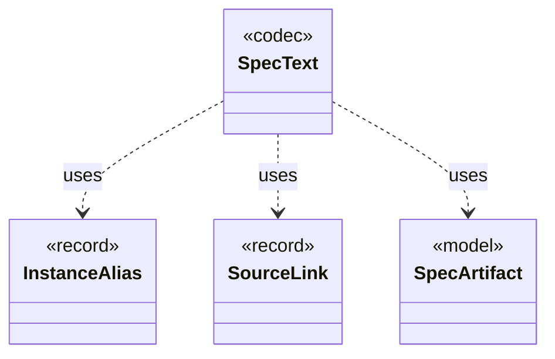

# `SpecText`

`io.github.tlaplus.hardening.workflow.spec` · class · codec · key · [source](https://github.com/tlaplus/model-checker-hardening/blob/ed5c97e61582ad2ff90b4ea4209355aa0d555717/src/main/java/io/github/tlaplus/hardening/workflow/spec/SpecText.java#L16) · module [workflow](../modules/workflow.md)

Renders an assembled module as the TLA+ source that the parser and TLC consume.

The diagram draws 3 of 11 relations; the table lists them all.

| Direction | Relation | Type | Summary |
|---|---|---|---|
| → | uses | [InstanceAlias](io.github.tlaplus.hardening.gen.library.InstanceAlias.md) | A library name the TLA+ source defines as `name(p1, ..., pn) == I!Operator(p1, ..., pn)`, where `I` is the named instance of `sourceModule`: the target's module, or the separate TLC module of a diff-linked one. |
| → | uses | [SourceLink](io.github.tlaplus.hardening.gen.library.SourceLink.md) | The module the parser and TLC evaluate, and the aliases its renderer must define through named instances. |
| → | uses | [SpecArtifact](io.github.tlaplus.hardening.workflow.spec.SpecArtifact.md) | One assembled module, what its checkers are asked about it, and what its decoder produced. |
| → | depends | [OperatorId](io.github.tlaplus.hardening.gen.library.OperatorId.md) | Case-sensitive identity of an exported operator, independent of its generated name. |
| → | depends | [ToolWorkerProtocol](io.github.tlaplus.hardening.workflow.worker.ToolWorkerProtocol.md) | Binary framing shared by isolated parser and model-checker workers. |
| ← | depends | [DecodedInputRenderer](io.github.tlaplus.hardening.cli.DecodedInputRenderer.md) | Renders a decoded input independently of picocli command wiring. |
| ← | depends | [RewriteReport](io.github.tlaplus.hardening.cli.RewriteReport.md) | Renders a metamorphic pair for triage (ADR 0016 §8): which side the checkers explore, the rules applied in order, and both sides. |
| ← | depends | [InputAdmission](io.github.tlaplus.hardening.workflow.input.InputAdmission.md) | Decides whether a decoded candidate enters `00-inputs`, and where a known defect goes. |
| ← | depends | [ParentPool](io.github.tlaplus.hardening.workflow.input.ParentPool.md) | The entries of `04quality-pass` that a generation mutates or adopts: those of the kind the run generates, read once when the generation starts. |
| ← | depends | [LibrarySourceProbe](io.github.tlaplus.hardening.workflow.library.LibrarySourceProbe.md) | Parses every source alias of a prepared library once, with the classpath the parser and TLC workers receive (ADR 0015). |
| ← | depends | [ToolBackend](io.github.tlaplus.hardening.workflow.tool.ToolBackend.md) | Tool-specific behavior injected into the shared `ToolStage`. |
