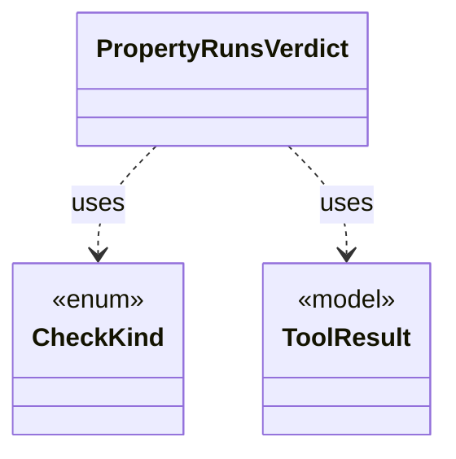

# `PropertyRunsVerdict`

`io.github.tlaplus.hardening.workflow.tlc` · class · other · [source](https://github.com/tlaplus/model-checker-hardening/blob/7d4f60afbf46c7ec2fc12dec60b7747fc5defc4c/src/main/java/io/github/tlaplus/hardening/workflow/tlc/PropertyRunsVerdict.java#L26) · module [workflow](../modules/workflow.md)

Folds the relation run of a metamorphic module and its two property runs into the one outcome of the TLC stage (ADR 0027 §4).

**Decisions:** [ADR 0027: Metamorphic testing of temporal properties](https://github.com/tlaplus/model-checker-hardening/blob/7d4f60afbf46c7ec2fc12dec60b7747fc5defc4c/docs/decisions/0027-temporal-metamorphic-testing.md)

The diagram draws 2 of 6 relations; the table lists them all.

| Direction | Relation | Type | Summary |
|---|---|---|---|
| → | uses | [CheckKind](io.github.tlaplus.hardening.workflow.worker.CheckKind.md) | What one checker invocation checks in an assembled module: which side's specification it explores, and whether it checks the invariant, the action invariant of a metamorphic module and a temporal property. |
| → | uses | [ToolResult](io.github.tlaplus.hardening.workflow.worker.ToolResult.md) | One request result returned by an isolated tool worker. |
| → | depends | [WorkflowException](io.github.tlaplus.hardening.workflow.WorkflowException.md) | Reports an infrastructure or lifecycle failure in a fuzzing workflow. |
| → | depends | [FuzzInputModule](io.github.tlaplus.hardening.workflow.spec.FuzzInputModule.md) | Assembles the module checked by the parser and model-checker stages. |
| → | depends | [StageOutcome](io.github.tlaplus.hardening.workflow.worker.StageOutcome.md) | Common result of processing one input in a checking stage. |
| ← | depends | [TlcCheckerBackend](io.github.tlaplus.hardening.workflow.tlc.TlcCheckerBackend.md) | Adapts fresh isolated TLC invocations to the shared tool stage. |
