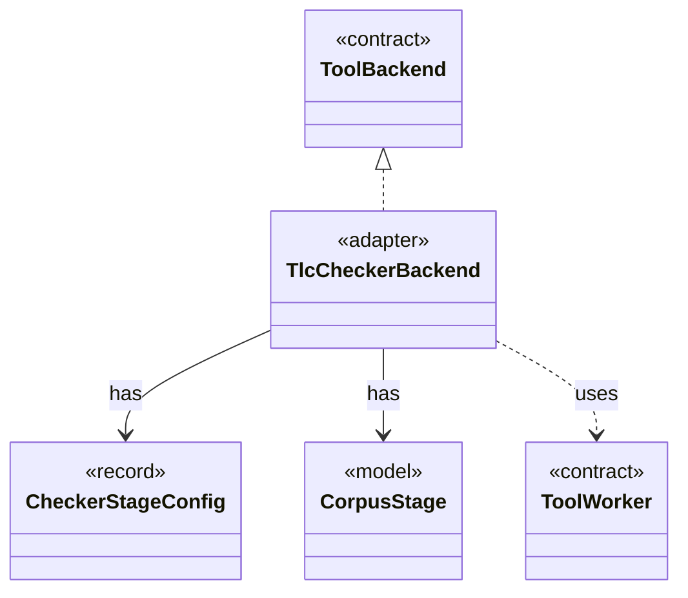

# `TlcCheckerBackend`

`io.github.tlaplus.hardening.workflow.tlc` · class · adapter · key · [source](https://github.com/tlaplus/model-checker-hardening/blob/47a7fcfd71d20c6a404ebf5a8a3e7d9a0e250e9b/src/main/java/io/github/tlaplus/hardening/workflow/tlc/TlcCheckerBackend.java#L20) · module [workflow](../modules/workflow.md)

Adapts fresh isolated TLC invocations to the shared tool stage.

The diagram draws 4 of 11 relations; the table lists them all.

| Direction | Relation | Type | Summary |
|---|---|---|---|
| → | implements | [ToolBackend](io.github.tlaplus.hardening.workflow.tool.ToolBackend.md) | Tool-specific behavior injected into the shared `ToolStage`. |
| → | has | [CheckerStageConfig](io.github.tlaplus.hardening.config.CheckerStageConfig.md) | Capacity and resource limits for one model-checker stage. |
| → | has | [CorpusStage](io.github.tlaplus.hardening.corpus.CorpusStage.md) | One implemented stage of the fuzzing pipeline, and the corpus directories it owns. |
| → | uses | [ToolWorker](io.github.tlaplus.hardening.workflow.tool.ToolWorker.md) | Worker-local tool state used for one or more sequential inputs. |
| → | depends | [Preconditions](io.github.tlaplus.hardening.common.Preconditions.md) | Shared validation of method and constructor arguments. |
| → | depends | [WorkflowException](io.github.tlaplus.hardening.workflow.WorkflowException.md) | Reports an infrastructure or lifecycle failure in a fuzzing workflow. |
| → | depends | [TlcFailureDetail](io.github.tlaplus.hardening.workflow.tlc.TlcFailureDetail.md) | Extracts bounded human-readable context from TLC diagnostics. |
| → | depends | [TlcProcess](io.github.tlaplus.hardening.workflow.tlc.TlcProcess.md) | Runs one TLC request in a fresh isolated JVM. |
| → | depends | [ToolInput](io.github.tlaplus.hardening.workflow.worker.ToolInput.md) | One rendered specification and what the receiving checker is asked about it. |
| → | depends | [ToolResult](io.github.tlaplus.hardening.workflow.worker.ToolResult.md) | One request result returned by an isolated tool worker. |
| ← | depends | [CheckerBackends](io.github.tlaplus.hardening.workflow.CheckerBackends.md) | How each model-checker stage builds its backend for one invocation. |
