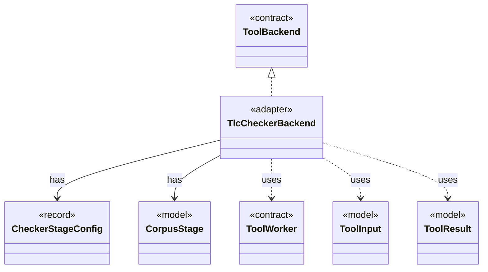

# `TlcCheckerBackend`

`io.github.tlaplus.hardening.workflow.tlc` · class · adapter · key · [source](https://github.com/tlaplus/model-checker-hardening/blob/21262d9d0cc07b5ae4c47c4ee511217c9b88b561/src/main/java/io/github/tlaplus/hardening/workflow/tlc/TlcCheckerBackend.java#L28) · module [workflow](../modules/workflow.md)

Adapts fresh isolated TLC invocations to the shared tool stage.

The diagram draws 6 of 15 relations; the table lists them all.

| Direction | Relation | Type | Summary |
|---|---|---|---|
| → | implements | [ToolBackend](io.github.tlaplus.hardening.workflow.tool.ToolBackend.md) | Tool-specific behavior injected into the shared `ToolStage`. |
| → | has | [CheckerStageConfig](io.github.tlaplus.hardening.config.CheckerStageConfig.md) | Capacity and resource limits for one model-checker stage. |
| → | has | [CorpusStage](io.github.tlaplus.hardening.corpus.CorpusStage.md) | One implemented stage of the fuzzing pipeline, and the corpus directories it owns. |
| → | uses | [ToolWorker](io.github.tlaplus.hardening.workflow.tool.ToolWorker.md) | Worker-local tool state used for one or more sequential inputs. |
| → | uses | [ToolInput](io.github.tlaplus.hardening.workflow.worker.ToolInput.md) | One rendered specification and what the receiving checker is asked about it. |
| → | uses | [ToolResult](io.github.tlaplus.hardening.workflow.worker.ToolResult.md) | One request result returned by an isolated tool worker. |
| → | depends | [Preconditions](io.github.tlaplus.hardening.common.Preconditions.md) | Shared validation of method and constructor arguments. |
| → | depends | [WorkflowException](io.github.tlaplus.hardening.workflow.WorkflowException.md) | Reports an infrastructure or lifecycle failure in a fuzzing workflow. |
| → | depends | [TlcFailureDetail](io.github.tlaplus.hardening.workflow.tlc.TlcFailureDetail.md) | Extracts bounded human-readable context from TLC diagnostics. |
| → | depends | [TlcWorkerMain](io.github.tlaplus.hardening.workflow.tlc.TlcWorkerMain.md) | One-shot TLC child process. |
| → | depends | [ChildJvm](io.github.tlaplus.hardening.workflow.worker.ChildJvm.md) | The resources and options of one child JVM. |
| → | depends | [IsolatedWorkerProcess](io.github.tlaplus.hardening.workflow.worker.IsolatedWorkerProcess.md) | Parent-side supervisor for one isolated Java tool worker. |
| → | depends | [JavaLaunch](io.github.tlaplus.hardening.workflow.worker.JavaLaunch.md) | How this project spells a child JVM launch, so every caller spells it the same way. |
| → | depends | [WorkerSpec](io.github.tlaplus.hardening.workflow.worker.WorkerSpec.md) | How to launch one isolated tool worker: where it may write, how long it may take to come up, which class it runs, what goes in front of this JVM's class path, the child JVM it runs in, and what to call it in diagnostics. |
| ← | depends | [CheckerBackends](io.github.tlaplus.hardening.workflow.CheckerBackends.md) | How each model-checker stage builds its backend for one invocation. |
