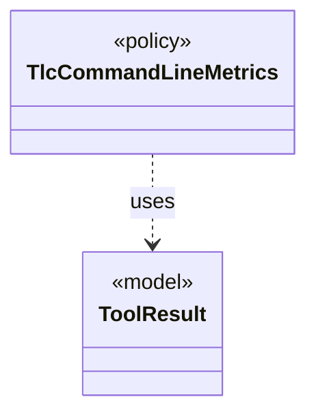

# `TlcCommandLineMetrics`

`io.github.tlaplus.hardening.workflow.tlc` · class · policy · key · [source](https://github.com/tlaplus/model-checker-hardening/blob/d4b229fc7366469558e1c11dfe92890fdc0a5049/src/main/java/io/github/tlaplus/hardening/workflow/tlc/TlcCommandLineMetrics.java#L19) · module [workflow](../modules/workflow.md)

Reads the size of a completed search from the statistics that TLC's command line prints, for a generic checker that follows TLC's output (ADR 0033 §5).

**Decisions:** [ADR 0033: A generic checker for TLC- and Apalache-compatible tools](https://github.com/tlaplus/model-checker-hardening/blob/d4b229fc7366469558e1c11dfe92890fdc0a5049/docs/decisions/0033-generic-checker.md)

The diagram draws 1 of 6 relations; the table lists them all.

| Direction | Relation | Type | Summary |
|---|---|---|---|
| → | uses | [ToolResult](io.github.tlaplus.hardening.workflow.worker.ToolResult.md) | One request result returned by an isolated tool worker. |
| → | depends | [ExplorationCount](io.github.tlaplus.hardening.checker.ExplorationCount.md) | A counted exploration metric. |
| → | depends | [ExplorationMetrics](io.github.tlaplus.hardening.checker.ExplorationMetrics.md) | What a model checker explored to reach its verdict, as ADR 0008 defines it. |
| → | depends | [ExplorationPhase](io.github.tlaplus.hardening.checker.ExplorationPhase.md) | How far a model checker got before its verdict was fixed. |
| → | depends | [StageOutcome](io.github.tlaplus.hardening.workflow.worker.StageOutcome.md) | Common result of processing one input in a checking stage. |
| ← | depends | [GenericConvention](io.github.tlaplus.hardening.workflow.generic.GenericConvention.md) | What a compatibility means to the generic checker (ADR 0033 §2): the configuration file written as `{config}`, how an exit status becomes a verdict, and which exploration metrics the tool's output gives (§5). |
