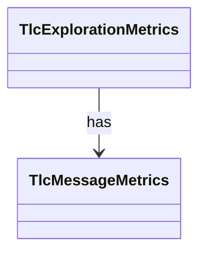

# `TlcMessageMetrics`

`io.github.tlaplus.hardening.workflow.tlc` · class · other · [source](https://github.com/tlaplus/model-checker-hardening/blob/47a7fcfd71d20c6a404ebf5a8a3e7d9a0e250e9b/src/main/java/io/github/tlaplus/hardening/workflow/tlc/TlcMessageMetrics.java#L14) · module [workflow](../modules/workflow.md)

Follows the messages TLC prints, which say when its initial states are complete and which states its error trace consists of.

| Direction | Relation | Type | Summary |
|---|---|---|---|
| ← | has | [TlcExplorationMetrics](io.github.tlaplus.hardening.workflow.tlc.TlcExplorationMetrics.md) | Measures one TLC run and attaches the result to its classified outcome (ADR 0008). |
