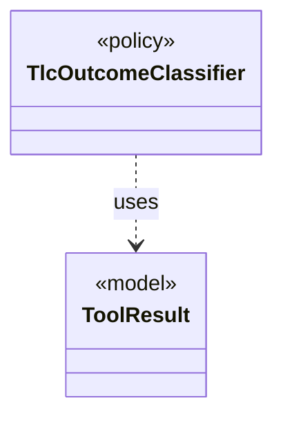

# `TlcOutcomeClassifier`

`io.github.tlaplus.hardening.workflow.tlc` · class · policy · key · [source](https://github.com/tlaplus/model-checker-hardening/blob/dd877bc2dce59141917dd1003529d40721d7efc1/src/main/java/io/github/tlaplus/hardening/workflow/tlc/TlcOutcomeClassifier.java#L15) · module [workflow](../modules/workflow.md)

Maps TLC's internal error constants and exit statuses to workflow outcomes, for TLC and for a generic checker that follows TLC's exit statuses (ADR 0033 §2).

**Decisions:** [ADR 0033: A generic checker for TLC- and Apalache-compatible tools](https://github.com/tlaplus/model-checker-hardening/blob/dd877bc2dce59141917dd1003529d40721d7efc1/docs/decisions/0033-generic-checker.md)

The diagram draws 1 of 5 relations; the table lists them all.

| Direction | Relation | Type | Summary |
|---|---|---|---|
| → | uses | [ToolResult](io.github.tlaplus.hardening.workflow.worker.ToolResult.md) | One request result returned by an isolated tool worker. |
| → | depends | [CheckerFailureCode](io.github.tlaplus.hardening.checker.CheckerFailureCode.md) | Stable failure codes shared by model-checker stages. |
| → | depends | [StageOutcome](io.github.tlaplus.hardening.workflow.worker.StageOutcome.md) | Common result of processing one input in a checking stage. |
| ← | depends | [GenericConvention](io.github.tlaplus.hardening.workflow.generic.GenericConvention.md) | What a compatibility means to the generic checker (ADR 0033 §2): the configuration file written as `{config}`, how an exit status becomes a verdict, and which exploration metrics the tool's output gives (§5). |
| ← | depends | [TlcWorkerMain](io.github.tlaplus.hardening.workflow.tlc.TlcWorkerMain.md) | One-shot TLC child process. |
