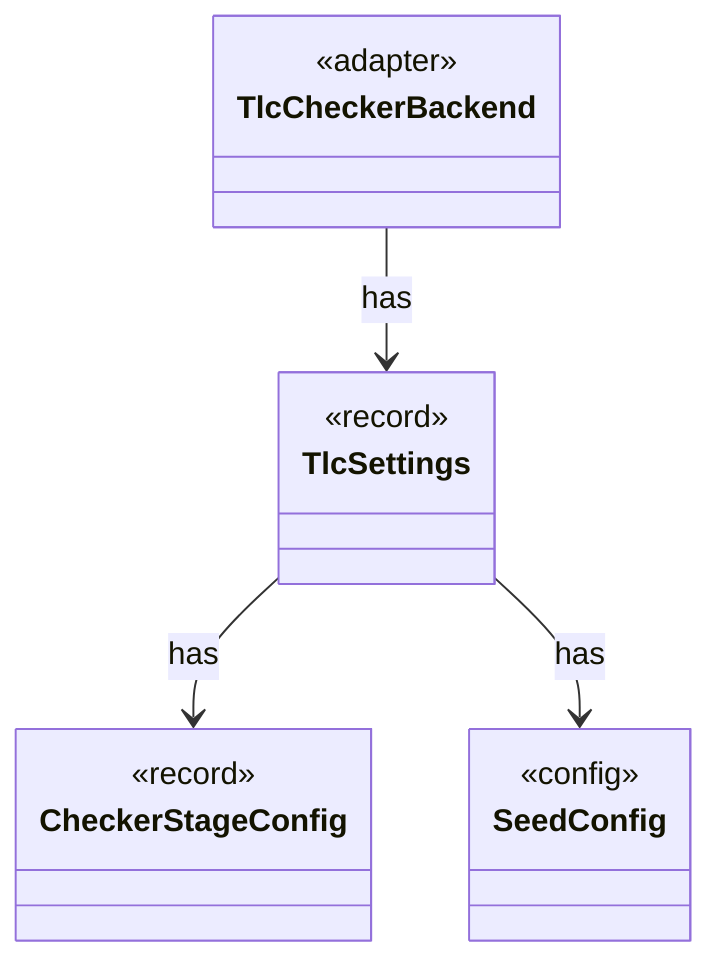

# `TlcSettings`

`io.github.tlaplus.hardening.workflow.tlc` · record · other · [source](https://github.com/tlaplus/model-checker-hardening/blob/5b16596dd480095d323ac67ff0f85eb85227b4b5/src/main/java/io/github/tlaplus/hardening/workflow/tlc/TlcSettings.java#L11) · module [workflow](../modules/workflow.md)

What one TLC stage launches its JVMs with: the stage's limits and the TLC seeds of ` [seeds]` (ADR 0026), which every TLC stage shares.

**Decisions:** [ADR 0026: Reproducible runs: seeds chosen at `init`, `run --continue`](https://github.com/tlaplus/model-checker-hardening/blob/5b16596dd480095d323ac67ff0f85eb85227b4b5/docs/decisions/0026-reproducible-runs.md)

The diagram draws 3 of 4 relations; the table lists them all.

| Direction | Relation | Type | Summary |
|---|---|---|---|
| → | has | [CheckerStageConfig](io.github.tlaplus.hardening.config.CheckerStageConfig.md) | Capacity and resource limits for one model-checker stage. |
| → | has | [SeedConfig](io.github.tlaplus.hardening.config.SeedConfig.md) | The `[seeds]` table (ADR 0026): every random seed a run uses. |
| ← | has | [TlcCheckerBackend](io.github.tlaplus.hardening.workflow.tlc.TlcCheckerBackend.md) | Adapts fresh isolated TLC invocations to the shared tool stage. |
| ← | depends | [CheckerBackends](io.github.tlaplus.hardening.workflow.CheckerBackends.md) | How each model-checker stage builds its backend for one invocation. |
