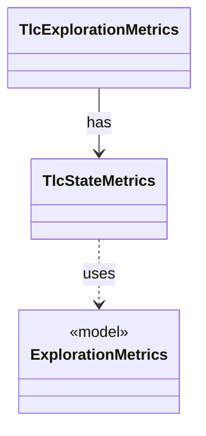

# `TlcStateMetrics`

`io.github.tlaplus.hardening.workflow.tlc` · class · other · [source](https://github.com/tlaplus/model-checker-hardening/blob/e180a3892e661e5d7ba7636c4f24a6fca66ded14/src/main/java/io/github/tlaplus/hardening/workflow/tlc/TlcStateMetrics.java#L31) · module [workflow](../modules/workflow.md)

Measures the state graph TLC explores, through the state-writer callbacks TLC makes for every initial state and every generated transition.

**Decisions:** [ADR 0024: Action coverage in the selection of graph entries](https://github.com/tlaplus/model-checker-hardening/blob/e180a3892e661e5d7ba7636c4f24a6fca66ded14/docs/decisions/0024-graph-action-coverage.md)

The diagram draws 2 of 4 relations; the table lists them all.

| Direction | Relation | Type | Summary |
|---|---|---|---|
| ← | has | [TlcExplorationMetrics](io.github.tlaplus.hardening.workflow.tlc.TlcExplorationMetrics.md) | Measures one TLC run and attaches the result to its classified outcome (ADR 0008). |
| → | uses | [ExplorationMetrics](io.github.tlaplus.hardening.checker.ExplorationMetrics.md) | What a model checker explored to reach its verdict, as ADR 0008 defines it. |
| → | depends | [ExplorationCount](io.github.tlaplus.hardening.checker.ExplorationCount.md) | A counted exploration metric. |
| → | depends | [TlcValueShape](io.github.tlaplus.hardening.workflow.tlc.TlcValueShape.md) | The shape of the values of one state: how many value nodes they hold, their largest collection, and their deepest nesting. |
