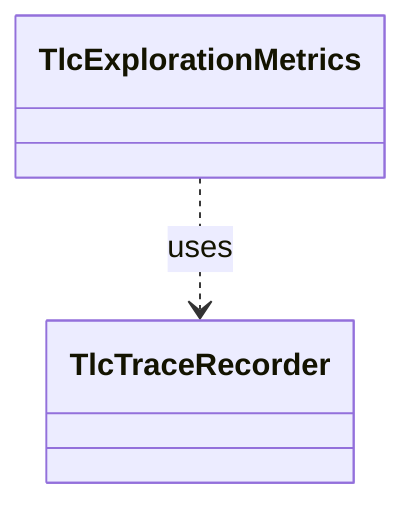

# `TlcTraceRecorder`

`io.github.tlaplus.hardening.workflow.tlc` · class · other · [source](https://github.com/tlaplus/model-checker-hardening/blob/1397e7b533b2a521ed26d8d6ad957519716682dc/src/main/java/io/github/tlaplus/hardening/workflow/tlc/TlcTraceRecorder.java#L37) · module [workflow](../modules/workflow.md)

Records the counterexample TLC prints (ADR 0034 §5), as the JSON a worker returns: its states in the Informal Trace Format and what its last state claims.

**Decisions:** [ADR 0034: Replaying counterexamples as corpus inputs](https://github.com/tlaplus/model-checker-hardening/blob/1397e7b533b2a521ed26d8d6ad957519716682dc/docs/decisions/0034-counterexample-replay.md)

The diagram draws 1 of 4 relations; the table lists them all.

| Direction | Relation | Type | Summary |
|---|---|---|---|
| ← | uses | [TlcExplorationMetrics](io.github.tlaplus.hardening.workflow.tlc.TlcExplorationMetrics.md) | Measures one TLC run and attaches the result to its classified outcome (ADR 0008). |
| → | depends | [FuzzInputModule](io.github.tlaplus.hardening.workflow.spec.FuzzInputModule.md) | Assembles the module checked by the parser and model-checker stages. |
| → | depends | [TlcItfValues](io.github.tlaplus.hardening.workflow.tlc.TlcItfValues.md) | Writes TLC's values in the Informal Trace Format (ADR 0034 §5), as a recorded trace carries them from the worker to its stage. |
| ← | depends | [TlcWorkerMain](io.github.tlaplus.hardening.workflow.tlc.TlcWorkerMain.md) | One-shot TLC child process. |
